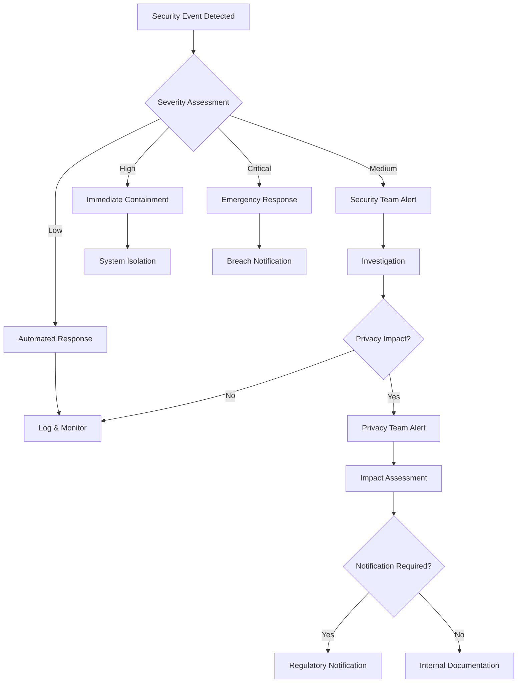

# Contact Discovery Security & Compliance Framework
*Privacy-First Implementation with Enterprise-Grade Security*

## Overview

This document defines the comprehensive security and compliance framework for the contact discovery feature, ensuring adherence to GDPR, CCPA, and other privacy regulations while implementing robust abuse prevention and security monitoring.

## Security Architecture

### 1. Data Protection Strategy

#### Cryptographic Processing
```typescript
// Server-side hashing implementation
interface ContactHashingService {
  // One-way hashing with salted SHA-256
  hashContact(identifier: string, type: 'email' | 'phone'): string;
  
  // Bloom filter for privacy-preserving matching
  createBloomFilter(contacts: string[]): BloomFilter;
  
  // Secure deletion with cryptographic erasure
  secureDelete(userId: string): Promise<void>;
}
```

**Key Principles:**
- **No plaintext storage**: Contact identifiers immediately hashed on server
- **Cryptographic salting**: Unique salts per tenant to prevent rainbow attacks
- **Secure key management**: AWS KMS/HashiCorp Vault integration for salt storage
- **Forward secrecy**: Key rotation every 90 days with backward deletion

#### Data Minimization
```sql
-- Contact storage schema (hashed identifiers only)
CREATE TABLE contact_hashes (
  id UUID PRIMARY KEY DEFAULT gen_random_uuid(),
  user_id UUID NOT NULL REFERENCES users(id),
  contact_hash VARCHAR(64) NOT NULL, -- SHA-256 hash
  contact_type contact_type NOT NULL,
  created_at TIMESTAMP DEFAULT NOW(),
  expires_at TIMESTAMP DEFAULT (NOW() + INTERVAL '90 days'),
  tenant_id VARCHAR(50) NOT NULL,
  INDEX idx_hash_lookup (contact_hash, contact_type),
  INDEX idx_expiration (expires_at)
);

-- No original contact data stored anywhere
-- No reverse lookup capability by design
```

### 2. Abuse Prevention

#### Rate Limiting Strategy
```typescript
interface ContactRateLimits {
  // Per-user limits
  uploadsPerHour: 5;
  contactsPerUpload: 1000;
  suggestionsPerHour: 100;
  
  // Per-IP limits (suspicious activity detection)
  uploadsPerIPPerHour: 20;
  uniqueUsersPerIPPerHour: 10;
  
  // Global circuit breakers
  maxConcurrentUploads: 1000;
  maxSystemLoad: 0.8;
}

// Implementation with existing rate limiting infrastructure
@Controller('contacts')
@UseGuards(RateLimitGuard)
@RateLimit({
  keyGenerator: (req) => `contact_upload:${req.user.id}`,
  max: 5, // 5 uploads per hour
  windowMs: 60 * 60 * 1000,
})
export class ContactsController {
  // Controller implementation
}
```

#### Suspicious Pattern Detection
```typescript
interface SecurityMonitoringService {
  // Detect rapid successive uploads
  detectBulkUploadAbuse(userId: string, uploadCount: number): boolean;
  
  // Identify contact farming patterns
  detectContactFarming(uploads: ContactUpload[]): SuspiciousActivity[];
  
  // Monitor suggestion scraping attempts
  detectSuggestionScraping(userId: string, requestPattern: RequestPattern): boolean;
  
  // Cross-reference with known bad actors
  checkUserReputation(userId: string, ipAddress: string): ReputationScore;
}

// Automated response system
interface AbuseResponse {
  // Temporary account restrictions
  limitAccountAccess(userId: string, duration: number): void;
  
  // Progressive penalties
  escalatePenalties(userId: string, violations: Violation[]): void;
  
  // Emergency containment
  quarantineAccount(userId: string, reason: string): void;
}
```

### 3. Privacy Controls Implementation

#### GDPR/CCPA Compliance Engine
```typescript
interface PrivacyComplianceService {
  // Right to Access (GDPR Article 15)
  generateDataExport(userId: string): Promise<PersonalDataExport>;
  
  // Right to Rectification (GDPR Article 16)
  updatePersonalData(userId: string, updates: DataUpdate[]): Promise<void>;
  
  // Right to Erasure (GDPR Article 17)
  deletePersonalData(userId: string, scope: DeletionScope): Promise<DeletionReport>;
  
  // Right to Data Portability (GDPR Article 20)
  exportPortableData(userId: string): Promise<PortableDataPackage>;
  
  // CCPA Do Not Sell My Personal Information
  optOutOfDataSale(userId: string): Promise<void>;
}

// Automated compliance workflows
interface ComplianceWorkflow {
  // 30-day deletion verification
  verifyDeletionCompleted(deletionId: string): Promise<boolean>;
  
  // Data retention policy enforcement
  enforceRetentionPolicies(): Promise<RetentionReport>;
  
  // Breach notification procedures
  handleDataBreach(incident: SecurityIncident): Promise<void>;
}
```

## Compliance Framework

### 1. GDPR Implementation

#### Legal Basis: Legitimate Interest (Article 6(1)(f))
```markdown
**Legitimate Interest Assessment:**
- Purpose: Friend discovery to enhance user experience
- Necessity: Contact matching requires contact data processing
- Balancing Test: User benefits vs privacy risks
- Safeguards: Cryptographic hashing, time-limited retention, easy opt-out

**User Rights Implementation:**
✅ Transparent information (Article 13)
✅ Access to personal data (Article 15)
✅ Rectification of data (Article 16)
✅ Erasure/Right to be forgotten (Article 17)
✅ Data portability (Article 20)
✅ Object to processing (Article 21)
```

#### Data Processing Record (Article 30)
```json
{
  "controller": {
    "name": "[Company Name]",
    "contact": "privacy@company.com",
    "dpo": "dpo@company.com"
  },
  "processing_activity": {
    "name": "Contact Discovery Service",
    "purpose": "Friend discovery and social connection",
    "legal_basis": "Legitimate interest (Article 6(1)(f))",
    "categories_of_data": [
      "Contact identifiers (hashed)",
      "User relationships (derived)",
      "Privacy preferences"
    ],
    "retention_period": "90 days maximum",
    "security_measures": [
      "Cryptographic hashing",
      "Access controls",
      "Audit logging",
      "Encrypted storage"
    ]
  }
}
```

### 2. CCPA Implementation

#### Consumer Rights Framework
```typescript
interface CCPAConsumerRights {
  // Right to Know (CCPA Section 1798.100)
  rightToKnow: {
    categoriesCollected: string[];
    purposesForCollection: string[];
    categoriesShared: string[];
    retentionPeriod: string;
  };
  
  // Right to Delete (CCPA Section 1798.105)
  rightToDelete: {
    deletionScope: 'partial' | 'complete';
    verificationRequired: boolean;
    exceptions: string[];
  };
  
  // Right to Opt-Out (CCPA Section 1798.120)
  rightToOptOut: {
    saleOptOut: boolean;
    targetedAdvertisingOptOut: boolean;
    profilingOptOut: boolean;
  };
  
  // Right to Non-Discrimination (CCPA Section 1798.125)
  rightToNonDiscrimination: {
    serviceRestrictions: boolean;
    pricingDifferences: boolean;
    incentivePrograms: string[];
  };
}
```

### 3. Audit Trail Implementation

#### Comprehensive Logging Strategy
```sql
-- Privacy action audit table
CREATE TABLE privacy_audit_log (
  id UUID PRIMARY KEY DEFAULT gen_random_uuid(),
  user_id UUID REFERENCES users(id),
  action_type privacy_action_type NOT NULL,
  action_details JSONB NOT NULL,
  requested_by VARCHAR(100), -- 'user' or admin ID
  processed_at TIMESTAMP DEFAULT NOW(),
  verification_method VARCHAR(50),
  legal_basis VARCHAR(100),
  retention_expires_at TIMESTAMP DEFAULT (NOW() + INTERVAL '7 years'),
  tenant_id VARCHAR(50) NOT NULL
);

-- Data processing log for compliance
CREATE TABLE data_processing_log (
  id UUID PRIMARY KEY DEFAULT gen_random_uuid(),
  processing_activity VARCHAR(100) NOT NULL,
  data_categories TEXT[] NOT NULL,
  legal_basis VARCHAR(100) NOT NULL,
  purpose TEXT NOT NULL,
  user_id UUID REFERENCES users(id),
  processed_at TIMESTAMP DEFAULT NOW(),
  retention_period INTERVAL,
  automated_decision BOOLEAN DEFAULT FALSE,
  tenant_id VARCHAR(50) NOT NULL
);
```

#### Audit Data Retention
```typescript
interface AuditRetentionPolicy {
  // EU requirements: 7 years for GDPR compliance
  gdprAuditLogs: '7 years';
  
  // US requirements: Varies by state
  ccpaAuditLogs: '3 years'; // California minimum
  
  // Security logs: Shorter retention for operational data
  securityLogs: '1 year';
  
  // Anonymization after retention period
  postRetentionAction: 'anonymize' | 'delete';
}
```

## Security Monitoring

### 1. Real-Time Threat Detection

#### Security Event Classification
```typescript
enum SecurityEventType {
  // Volume-based attacks
  BULK_UPLOAD_ABUSE = 'bulk_upload_abuse',
  SUGGESTION_SCRAPING = 'suggestion_scraping',
  RATE_LIMIT_EXCEEDED = 'rate_limit_exceeded',
  
  // Pattern-based attacks
  CONTACT_FARMING = 'contact_farming',
  AUTOMATED_BEHAVIOR = 'automated_behavior',
  SUSPICIOUS_LOCATION = 'suspicious_location',
  
  // Privacy violations
  UNAUTHORIZED_ACCESS = 'unauthorized_access',
  DATA_EXFILTRATION = 'data_exfiltration',
  CONSENT_BYPASS = 'consent_bypass',
  
  // Technical attacks
  INJECTION_ATTEMPT = 'injection_attempt',
  PRIVILEGE_ESCALATION = 'privilege_escalation',
  API_ABUSE = 'api_abuse'
}

interface SecurityAlert {
  eventType: SecurityEventType;
  severity: 'low' | 'medium' | 'high' | 'critical';
  userId?: string;
  ipAddress: string;
  userAgent: string;
  correlationId: string;
  evidence: Record<string, any>;
  automaticResponse: boolean;
  timestamp: Date;
}
```

#### Automated Response Matrix
```typescript
interface SecurityResponseMatrix {
  [SecurityEventType.BULK_UPLOAD_ABUSE]: {
    threshold: 10; // uploads per hour
    response: 'rate_limit_increase';
    escalation: 'account_review';
    duration: 24; // hours
  };
  
  [SecurityEventType.SUGGESTION_SCRAPING]: {
    threshold: 100; // suggestions per hour
    response: 'api_throttling';
    escalation: 'account_suspension';
    duration: 6; // hours
  };
  
  [SecurityEventType.CONTACT_FARMING]: {
    threshold: 5000; // contacts per upload
    response: 'account_quarantine';
    escalation: 'manual_review';
    duration: 72; // hours
  };
}
```

### 2. Privacy Breach Response

#### Incident Response Workflow


#### Breach Notification Automation
```typescript
interface BreachNotificationService {
  // GDPR: 72-hour notification to DPA
  notifyDataProtectionAuthority(
    incident: SecurityIncident,
    impactAssessment: PrivacyImpactAssessment
  ): Promise<void>;
  
  // User notification for high-risk breaches
  notifyAffectedUsers(
    userIds: string[],
    breachDetails: UserNotificationDetails
  ): Promise<void>;
  
  // Internal stakeholder alerts
  alertSecurityTeam(incident: SecurityIncident): Promise<void>;
  alertPrivacyTeam(incident: SecurityIncident): Promise<void>;
  alertExecutiveTeam(incident: SecurityIncident): Promise<void>;
}
```

## Data Retention & Deletion

### 1. Automated Retention Management

#### Lifecycle Management Service
```typescript
interface DataLifecycleService {
  // Automatic deletion after 90 days
  scheduleAutomaticDeletion(uploadId: string, createdAt: Date): void;
  
  // Process daily deletion queue
  processExpirationQueue(): Promise<DeletionReport>;
  
  // Verify deletion completion
  verifyDeletionCompleted(deletionId: string): Promise<boolean>;
  
  // Emergency data purge
  emergencyPurge(userId: string, reason: string): Promise<void>;
}

// Cron job implementation
@Cron('0 2 * * *') // Daily at 2 AM
async processExpiredData() {
  const expiredRecords = await this.findExpiredContacts();
  
  for (const record of expiredRecords) {
    await this.secureDelete(record);
    await this.logDeletion(record);
  }
  
  await this.generateDeletionReport(expiredRecords.length);
}
```

#### Secure Deletion Implementation
```sql
-- Cryptographic erasure procedure
CREATE OR REPLACE FUNCTION secure_delete_contacts(target_user_id UUID)
RETURNS INTEGER AS $$
DECLARE
  deleted_count INTEGER;
BEGIN
  -- Delete contact hashes
  DELETE FROM contact_hashes 
  WHERE user_id = target_user_id;
  
  GET DIAGNOSTICS deleted_count = ROW_COUNT;
  
  -- Delete suggestions
  DELETE FROM friend_suggestions 
  WHERE suggested_to = target_user_id 
     OR suggested_user = target_user_id;
  
  -- Delete processing metadata
  DELETE FROM upload_metadata 
  WHERE user_id = target_user_id;
  
  -- Log deletion for audit
  INSERT INTO privacy_audit_log (
    user_id, 
    action_type, 
    action_details,
    processed_at
  ) VALUES (
    target_user_id,
    'data_deletion',
    jsonb_build_object(
      'deleted_contacts', deleted_count,
      'deletion_method', 'secure_erasure'
    ),
    NOW()
  );
  
  RETURN deleted_count;
END;
$$ LANGUAGE plpgsql;
```

### 2. Compliance Verification

#### Data Inventory Service
```typescript
interface DataInventoryService {
  // Generate personal data report for user
  generatePersonalDataReport(userId: string): Promise<{
    contactsStored: number;
    uploadDate: Date;
    retentionExpires: Date;
    suggestionsGenerated: number;
    privacySettings: PrivacySettings;
  }>;
  
  // Verify no data remains after deletion
  verifyDataErasure(userId: string): Promise<ErasureVerificationReport>;
  
  // Generate compliance reports
  generateComplianceReport(
    startDate: Date,
    endDate: Date
  ): Promise<ComplianceReport>;
}

interface ComplianceReport {
  period: { start: Date; end: Date };
  metrics: {
    totalUsers: number;
    contactUploads: number;
    privacyRequests: number;
    deletionRequests: number;
    dataBreaches: number;
  };
  compliance: {
    averageDeletionTime: number; // hours
    gdprRequestResponse: number; // hours
    ccpaRequestResponse: number; // hours
    retentionPolicyCompliance: number; // percentage
  };
  incidents: SecurityIncident[];
}
```

## Implementation Checklist

### Pre-Production Security Review
- [ ] Penetration testing completed
- [ ] Code security audit by third party
- [ ] Privacy impact assessment approved
- [ ] Legal review of compliance measures
- [ ] Data protection officer approval
- [ ] Security team sign-off

### Compliance Validation
- [ ] GDPR compliance verification
- [ ] CCPA compliance verification
- [ ] SOC 2 Type II audit preparation
- [ ] ISO 27001 alignment check
- [ ] Regional privacy law review
- [ ] Data Processing Agreements updated

### Monitoring & Alerting
- [ ] Security monitoring dashboards configured
- [ ] Compliance metrics tracking implemented
- [ ] Automated alert thresholds set
- [ ] Incident response runbooks prepared
- [ ] Breach notification procedures tested
- [ ] Privacy team escalation paths defined

### Documentation & Training
- [ ] Privacy policy updated
- [ ] Terms of service updated
- [ ] Employee privacy training completed
- [ ] Security incident response training
- [ ] Compliance documentation archived
- [ ] User education materials prepared

## Security Testing Scenarios

### 1. Abuse Prevention Testing
```typescript
describe('Contact Upload Abuse Prevention', () => {
  test('Rate limiting prevents bulk uploads', async () => {
    // Attempt 10 uploads in 1 minute
    // Expect: 5 successful, 5 rate limited
  });
  
  test('Contact farming detection triggers', async () => {
    // Upload 10,000 contacts
    // Expect: Account quarantine
  });
  
  test('Suggestion scraping prevention', async () => {
    // Request 500 suggestions in 1 minute
    // Expect: API throttling
  });
});
```

### 2. Privacy Compliance Testing
```typescript
describe('GDPR Compliance', () => {
  test('Right to deletion within 30 days', async () => {
    // Request deletion
    // Verify complete erasure within 30 days
  });
  
  test('Data export includes all personal data', async () => {
    // Request data export
    // Verify completeness and accuracy
  });
  
  test('Consent withdrawal stops processing', async () => {
    // Withdraw consent
    // Verify no further processing
  });
});
```

### 3. Security Monitoring Testing
```typescript
describe('Security Event Detection', () => {
  test('Anomalous IP activity triggers alert', async () => {
    // Multiple users from same IP
    // Expect: Security alert
  });
  
  test('Automated behavior detection', async () => {
    // Scripted API calls
    // Expect: Bot detection
  });
  
  test('Data exfiltration prevention', async () => {
    // Attempt to extract all user data
    // Expect: Access denial and alert
  });
});
```

This comprehensive security and compliance framework ensures that the contact discovery feature meets enterprise-grade security standards while maintaining full compliance with global privacy regulations.