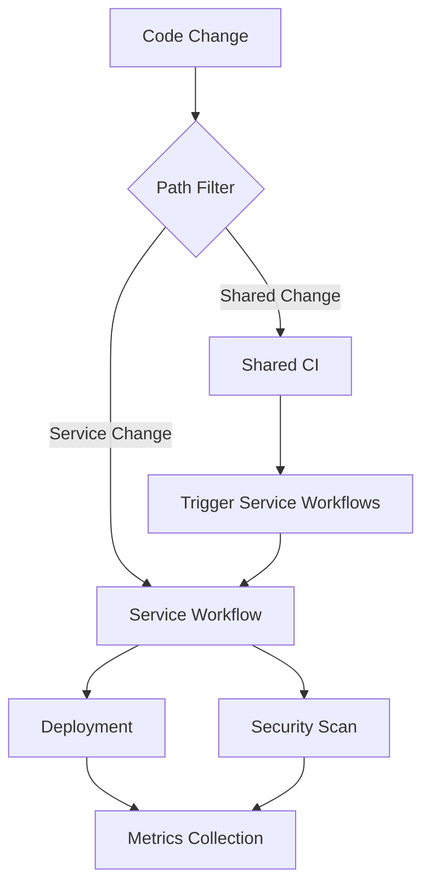

# CI/CD Workflows - Operations Runbook

## Overview

This runbook documents the comprehensive CI/CD workflow system for the auth-services monorepo, designed with path filters for selective builds, optimized performance, and enterprise-grade observability.

## Table of Contents

1. [Workflow Architecture](#workflow-architecture)
2. [Path Filtering Strategy](#path-filtering-strategy)
3. [Service-Specific Workflows](#service-specific-workflows)
4. [Shared Dependencies](#shared-dependencies)
5. [Deployment Pipelines](#deployment-pipelines)
6. [Performance Optimization](#performance-optimization)
7. [Security & Compliance](#security--compliance)
8. [Metrics & Monitoring](#metrics--monitoring)
9. [Troubleshooting Guide](#troubleshooting-guide)
10. [Maintenance Procedures](#maintenance-procedures)

## Workflow Architecture

### Core Workflows

| Workflow | Purpose | Triggers | Duration |
|----------|---------|----------|----------|
| `signup-service.yml` | NestJS signup service CI/CD | Service changes, shared deps | ~15 min |
| `login-service.yml` | Adaptive login service CI/CD | Service changes, shared deps | ~18 min |
| `shared-ci.yml` | Cross-service dependency validation | Shared code changes | ~8 min |
| `deployment.yml` | Environment deployments | Successful CI runs, manual | ~25 min |
| `security.yml` | Security scans & compliance | Daily, code changes | ~20 min |
| `metrics.yml` | CI metrics & monitoring | All workflow completions | ~5 min |

### Workflow Dependencies



## Path Filtering Strategy

### Filter Patterns

#### Signup Service Filters
```yaml
paths:
  - 'services/personal-email-signup-backend/**'
  - 'src/**'                    # Shared source
  - 'scripts/**'                # Shared scripts
  - 'docs/**'                   # Documentation
  - 'policies/**'               # Security policies
  - '.github/workflows/signup-service.yml'
```

#### Login Service Filters
```yaml
paths:
  - 'services/login-page-back/**'
  - 'src/**'                    # Shared source
  - 'scripts/**'                # Shared scripts  
  - 'docs/**'                   # Documentation
  - 'policies/**'               # Security policies
  - '.github/workflows/login-service.yml'
```

#### Shared Dependencies Filters
```yaml
paths:
  - 'src/**'                    # Contact import, shared utilities
  - 'scripts/**'                # Sync tools, validation scripts
  - 'policies/**'               # Cross-service policies
  - '.github/workflows/**'      # Workflow changes
  - '.github/CODEOWNERS'        # Ownership changes
```

### Path Filter Testing

```bash
# Test path filters locally
git diff --name-only HEAD~1 | grep -E "services/personal-email-signup-backend/|src/|scripts/"

# Validate filter patterns
echo "services/personal-email-signup-backend/src/app.ts" | grep -E "services/personal-email-signup-backend/"
```

## Service-Specific Workflows

### Signup Service Workflow (`signup-service.yml`)

#### Features
- **NestJS-optimized**: Full TypeScript compilation, testing matrix
- **Database services**: PostgreSQL + Redis for testing
- **Test types**: Unit, integration, contract, E2E
- **Performance testing**: Load tests on main branch
- **Docker builds**: Optimized multi-stage builds

#### Configuration
```yaml
env:
  SERVICE_NAME: personal-email-signup-backend
  SERVICE_PATH: services/personal-email-signup-backend
  NODE_VERSION: 18.x
  REGISTRY: ghcr.io
```

#### Test Matrix
- **Node versions**: 18.x, 20.x
- **Test types**: unit, integration, contract
- **Databases**: PostgreSQL 15, Redis 7
- **Parallel execution**: Independent test suites

### Login Service Workflow (`login-service.yml`)

#### Features  
- **Adaptive build system**: Detects Node.js, Docker, Make, or custom
- **Structure analysis**: Automatic build system detection
- **Flexible testing**: Supports various test configurations
- **Legacy support**: Works with diverse project structures

#### Build Detection Logic
```bash
if [ -f "package.json" ]; then
  build_system="nodejs"
elif [ -f "Dockerfile" ]; then
  build_system="docker"  
elif [ -f "Makefile" ]; then
  build_system="make"
else
  build_system="custom"
fi
```

#### Test Execution
- **Node.js projects**: npm test, lint, build
- **Custom projects**: Script discovery and execution
- **Docker projects**: Container-based testing
- **Fallback**: Manual test discovery

## Shared Dependencies

### Shared CI Workflow (`shared-ci.yml`)

#### Change Detection
Uses `dorny/paths-filter` for granular change detection:

```yaml
filters: |
  src:
    - 'src/**'
  scripts:
    - 'scripts/**'
  policies:
    - 'policies/**'
  docs:
    - 'docs/**'
```

#### Validation Pipeline
1. **Source validation**: TypeScript checking, import validation
2. **Script validation**: Syntax checking, permission verification
3. **Policy validation**: Markdown structure, content compliance
4. **Security scanning**: Secret detection, pattern analysis
5. **Integration testing**: Cross-service compatibility

#### Downstream Triggering
```yaml
# Automatic service workflow triggering
- name: Trigger service workflows
  if: contains(outputs.affected-services, 'signup')
  uses: actions/github-script@v7
  with:
    script: |
      github.rest.actions.createWorkflowDispatch({
        workflow_id: 'signup-service.yml',
        ref: context.ref
      });
```

## Deployment Pipelines

### Deployment Strategy

#### Automatic Deployments
- **Staging**: Automatic on successful main branch CI
- **Production**: Manual approval required
- **Rollback**: Automatic on failed validation

#### Environment Configuration
```yaml
environments:
  staging:
    url: https://signup-staging.yourdomain.com
    protection: none
  production:
    url: https://signup.yourdomain.com
    protection: required_reviewers
```

#### Deployment Process
1. **Strategy determination**: Service selection, environment targeting
2. **Pre-deployment validation**: Health checks, image verification
3. **Database migrations**: Schema updates, data migrations
4. **Service deployment**: Rolling updates, configuration application
5. **Post-deployment validation**: Health checks, smoke tests
6. **Rollback capability**: Automatic failure recovery

### Database Migrations

#### Migration Strategy
```bash
# Signup service migrations
cd services/personal-email-signup-backend
npm run migration:deploy

# Migration status validation
npm run migration:status
```

#### Safety Measures
- **Backup validation**: Pre-migration database state
- **Rollback scripts**: Automatic schema rollback
- **Status monitoring**: Migration progress tracking

## Performance Optimization

### Caching Strategies

#### Node.js Dependencies
```yaml
- name: Cache node modules
  uses: actions/cache@v4
  with:
    path: |
      services/*/node_modules
      services/*/.npm
    key: ${{ runner.os }}-${{ service }}-${{ hashFiles('**/package-lock.json') }}
    restore-keys: |
      ${{ runner.os }}-${{ service }}-
```

#### Docker Layer Caching
```yaml
- name: Build with cache
  uses: docker/build-push-action@v5
  with:
    cache-from: type=gha
    cache-to: type=gha,mode=max
```

### Parallel Execution

#### Matrix Builds
```yaml
strategy:
  matrix:
    service: [signup, login]
    node-version: [18.x, 20.x]
    test-type: [unit, integration]
  fail-fast: false
```

#### Conditional Steps
```yaml
- name: Run tests
  if: needs.detect-changes.outputs.any-changed == 'true'
  run: npm test
```

### Timeout Management
```yaml
timeout-minutes: 20  # Prevent runaway builds
```

## Security & Compliance

### Security Workflow (`security.yml`)

#### Scan Types
- **Dependencies**: npm audit, license compliance
- **Secrets**: GitLeaks, pattern matching
- **SAST**: Static analysis, dangerous pattern detection
- **Docker**: Container vulnerability scanning
- **Compliance**: Policy adherence, data protection

#### Scan Configuration
```yaml
inputs:
  scan_type:
    type: choice
    options: [full, dependencies, secrets, compliance]
```

#### Vulnerability Handling
```bash
# Critical vulnerability threshold
if [[ $critical -gt 0 ]]; then
  echo "❌ Critical vulnerabilities found: $critical"
  exit 1
elif [[ $high -gt 0 ]]; then
  echo "⚠️ High vulnerabilities found: $high"
  [[ "${{ github.event_name }}" != "schedule" ]] && exit 1
fi
```

### Compliance Checks
- **Required files**: Security policies, data retention
- **CI security**: Secret management, permissions
- **Data protection**: GDPR compliance, privacy policies

## Metrics & Monitoring

### Metrics Collection (`metrics.yml`)

#### Performance Metrics
- **Success rates**: Per workflow, overall system
- **Duration metrics**: Average, min, max build times  
- **Cache efficiency**: Hit rates, performance impact
- **Quality metrics**: Test coverage, security issues

#### Alerting Thresholds
```bash
# Performance scoring
if (( performance_score >= 85 )); then
  alert_level="info"
elif (( performance_score >= 70 )); then
  alert_level="warning"  
else
  alert_level="critical"
fi
```

#### Dashboard Generation
- **HTML dashboard**: Visual metrics overview
- **JSON API**: External system integration
- **Trend analysis**: Weekly performance trends

### Monitoring Integration

#### Slack Notifications
```json
{
  "text": "🚨 CI/CD performance is critical (65/100)",
  "blocks": [
    {
      "type": "section",
      "text": {
        "type": "mrkdwn", 
        "text": "*CI/CD Metrics Report*\n⚠️ Performance needs attention"
      }
    }
  ]
}
```

#### GitHub Issues
- **Critical alerts**: Automatic issue creation
- **Performance tracking**: Trend monitoring
- **Team assignment**: Automatic escalation

## Troubleshooting Guide

### Common Issues

#### Path Filter Not Triggering

**Symptoms**: Workflow not running despite file changes
**Diagnosis**:
```bash
# Check if files match path patterns
git diff --name-only HEAD~1 | grep -E "services/signup/"
```
**Solution**: 
- Verify path patterns in workflow YAML
- Check for typos in path specifications
- Ensure paths use forward slashes

#### Build Cache Misses

**Symptoms**: Slow builds, dependencies reinstalling
**Diagnosis**:
```bash
# Check cache key consistency
echo "Key: ${{ runner.os }}-${{ service }}-${{ hashFiles('package-lock.json') }}"
```
**Solution**:
- Verify cache key stability
- Check for package-lock.json changes
- Validate cache path specifications

#### Test Failures in Matrix Builds

**Symptoms**: Some matrix jobs failing, others passing
**Diagnosis**:
```bash
# Check specific matrix combination
echo "Node: ${{ matrix.node-version }}, Test: ${{ matrix.test-type }}"
```
**Solution**:
- Review test compatibility across Node versions
- Check environment variable differences
- Validate test isolation

#### Deployment Rollback Issues

**Symptoms**: Failed rollback, service downtime
**Diagnosis**:
```bash
# Check deployment history
kubectl rollout history deployment/signup-service
```
**Solution**:
- Verify rollback script functionality
- Check deployment configuration
- Validate health check endpoints

### Debug Commands

#### Workflow Debugging
```bash
# Enable debug logging
echo "::debug::Debugging workflow execution"

# Set workflow variables
echo "SERVICE_PATH=${{ env.SERVICE_PATH }}"
echo "BUILD_TYPE=${{ steps.detect.outputs.build_type }}"
```

#### Service Health Checks
```bash
# Health endpoint testing
curl -f https://signup-staging.yourdomain.com/health

# Database connectivity
npm run migration:status

# Cache connectivity  
redis-cli ping
```

#### Performance Analysis
```bash
# Build time analysis
time npm run build

# Test execution time
time npm test

# Cache analysis
du -sh node_modules/
```

## Maintenance Procedures

### Weekly Maintenance

#### Dependency Updates
```bash
# Check for outdated dependencies
npm outdated

# Security audit
npm audit

# Update non-breaking changes
npm update
```

#### Workflow Review
1. **Performance metrics**: Review weekly CI dashboard
2. **Failure analysis**: Investigate recurring failures  
3. **Cache optimization**: Monitor hit rates
4. **Security updates**: Review vulnerability reports

#### Cache Cleanup
```bash
# Clear old caches (automated)
gh api repos/:owner/:repo/actions/caches --paginate
```

### Monthly Maintenance

#### Workflow Optimization
1. **Build time analysis**: Identify optimization opportunities
2. **Test suite review**: Remove redundant tests
3. **Dependency audit**: Remove unused packages
4. **Security compliance**: Update security policies

#### Documentation Updates
1. **Runbook updates**: Reflect workflow changes
2. **Troubleshooting guide**: Add new solutions
3. **Architecture docs**: Update system diagrams
4. **Team training**: Share best practices

### Quarterly Maintenance

#### Infrastructure Review
1. **Runner performance**: Evaluate GitHub runner efficiency
2. **External services**: Review third-party integrations
3. **Cost optimization**: Analyze CI resource usage
4. **Capacity planning**: Project future requirements

#### Disaster Recovery Testing
1. **Backup validation**: Test deployment rollbacks
2. **Security incident response**: Simulate security events
3. **Service recovery**: Test service restoration procedures
4. **Data integrity**: Validate backup and recovery processes

### Emergency Procedures

#### CI System Outage
1. **Assessment**: Determine scope and impact
2. **Communication**: Notify development teams
3. **Workaround**: Enable manual deployment procedures
4. **Recovery**: Restore CI functionality
5. **Post-mortem**: Document lessons learned

#### Security Incident
1. **Isolation**: Disable affected workflows
2. **Investigation**: Analyze security breach
3. **Remediation**: Apply security patches
4. **Validation**: Verify system integrity
5. **Communication**: Report to stakeholders

## Contact Information

### Team Responsibilities

| Component | Primary Contact | Backup | Escalation |
|-----------|----------------|--------|------------|
| **CI/CD Platform** | Platform Team | DevOps Team | Engineering Lead |
| **Signup Service** | @Harishraghave-07 | Platform Team | Product Lead |
| **Login Service** | @jaidevms | Platform Team | Security Team |
| **Security** | Security Team | Platform Team | CISO |
| **Infrastructure** | DevOps Team | Platform Team | Infrastructure Lead |

### Support Channels

| Issue Type | Contact Method | Response Time |
|------------|---------------|---------------|
| **Build Failures** | #ci-cd-support | < 2 hours |
| **Deployment Issues** | #deployments | < 1 hour |
| **Security Alerts** | #security-incidents | < 30 minutes |
| **Emergency** | oncall@company.com | < 15 minutes |

### Escalation Procedures

1. **Level 1**: Team self-resolution (< 2 hours)
2. **Level 2**: Platform team engagement (< 4 hours)
3. **Level 3**: Engineering leadership (< 8 hours)
4. **Level 4**: Executive escalation (> 8 hours)

---

**Document Version**: 1.0  
**Last Updated**: October 10, 2025  
**Next Review**: January 10, 2026  
**Maintainer**: Platform Team