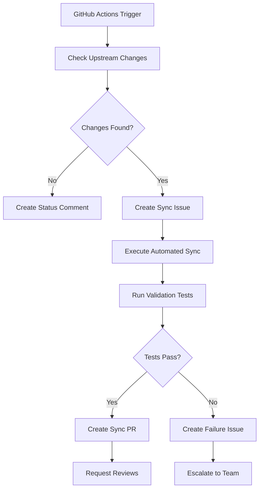

# Monorepo Upstream Sync Implementation Summary

## Overview

Successfully established a comprehensive Git workflow for syncing upstream changes from the original repositories into the auth-services monorepo using git subtree. The implementation preserves history, maintains monorepo-specific customizations, and provides automated monitoring.

## Implementation Components

### 1. Documentation and Runbooks

| File | Purpose | Status |
|------|---------|--------|
| `SYNC.md` | Comprehensive sync documentation and procedures | ✅ Complete |
| `policies/upstream-sync-policy.md` | Detailed policies, ownership, and escalation procedures | ✅ Complete |
| `RUNBOOK_SUBTREE_SYNC.md` | Existing runbook (legacy) | ✅ Updated Reference |

### 2. Automation Scripts

| Script | Purpose | Features | Status |
|--------|---------|----------|--------|
| `scripts/sync-upstream.sh` | Automated sync execution | Dry-run, validation, logging, error handling | ✅ Complete |

**Key Features:**
- ✅ Dry-run mode for safe preview
- ✅ Automated conflict detection
- ✅ Comprehensive validation testing
- ✅ Structured logging and reporting
- ✅ Error handling and rollback guidance

### 3. CI/CD Integration

| Workflow | Trigger | Purpose | Status |
|----------|---------|---------|--------|
| `.github/workflows/upstream-sync.yml` | Weekly schedule + manual | Automated sync monitoring and execution | ✅ Complete |

**Capabilities:**
- ✅ Weekly upstream change detection
- ✅ Automated sync execution
- ✅ PR creation for review
- ✅ Failure detection and escalation
- ✅ Issue tracking and notifications

### 4. Repository Configuration

| Component | Configuration | Status |
|-----------|---------------|--------|
| **Upstream Remotes** | `upstream-login`, `upstream-signup` | ✅ Configured |
| **Original Sources** | `jaidevms/login-page-back`, `Harishraghave-07/personal-email-signup-backend` | ✅ Linked |
| **Sync History** | Git subtree metadata preserved | ✅ Maintained |

## Sync Process Workflow

### 1. Regular Sync (Weekly)


### 2. Manual Sync Process
```bash
# 1. Preview changes
./scripts/sync-upstream.sh --dry-run

# 2. Execute sync
./scripts/sync-upstream.sh

# 3. Review and merge
git checkout sync/upstream-changes-$(date +%Y-%m-%d)
# Review changes, create PR, merge after approval
```

## Conflict Resolution Strategy

### Priority Framework

| Priority | Type | Resolution Strategy | Timeline |
|----------|------|-------------------|-----------|
| **P1** | Security patches | Always adopt upstream | < 4 hours |
| **P2** | Breaking changes | Careful integration + testing | < 24 hours |
| **P3** | Features | Evaluate compatibility | < 1 week |
| **P4** | Documentation | Merge with monorepo docs | Next sync cycle |

### Monorepo Customizations (Always Preserve)

1. **Observability Integration**
   - OpenTelemetry instrumentation
   - Prometheus metrics
   - Structured logging with correlation IDs

2. **Shared Infrastructure**
   - Cross-service configuration
   - Shared middleware and utilities
   - Monorepo-specific CI/CD

3. **Security Enhancements**
   - Additional security policies
   - Enhanced authentication flows
   - Audit trail requirements

## Testing and Validation

### Automated Validation Pipeline
```bash
npm run type-check    # TypeScript compilation
npm run lint          # Code quality checks
npm test             # Unit test suite
npm run test:integration  # Integration tests

# Service-specific validation
cd services/login-page-back && npm test
cd services/personal-email-signup-backend && npm test
```

### Manual Validation Checklist
- [ ] Authentication flows work correctly
- [ ] Database operations complete successfully
- [ ] Observability metrics are collected
- [ ] Cross-service communication functions
- [ ] Performance remains within acceptable ranges

## Monitoring and Alerting

### Sync Success Metrics
- **Sync completion rate**: Target >95%
- **Time to sync**: Target <30 minutes
- **Conflict resolution time**: Target <2 hours
- **Post-sync incident rate**: Target <5%

### Alerting Configuration
- ✅ Sync failure notifications
- ✅ Performance degradation alerts
- ✅ Conflict resolution escalation
- ✅ Security patch prioritization

## Ownership and Responsibilities

### Team Assignments

| Role | Primary Owner | Backup | Escalation |
|------|---------------|--------|------------|
| **Platform Operations** | Platform Team | DevOps Team | Engineering Leadership |
| **Login Service** | @jaidevms | Platform Team | Security Team |
| **Signup Service** | @Harishraghave-07 | Platform Team | Security Team |
| **Security Reviews** | Security Team | Platform Team | CISO |

### Contact Information

| Scenario | Contact Method | Response Time |
|----------|----------------|---------------|
| **Business Hours** | Slack #platform-team | < 2 hours |
| **After Hours** | oncall@company.com | < 1 hour |
| **Security Issues** | security-emergency@company.com | < 30 minutes |
| **Critical Escalation** | escalation@company.com | < 15 minutes |

## Success Metrics and Validation

### Implementation Success Criteria

✅ **Documented Process**: Comprehensive documentation created
✅ **Remote Configuration**: Upstream remotes properly configured
✅ **Automation**: Sync script with dry-run and validation
✅ **CI/CD Integration**: GitHub Actions workflow operational
✅ **Conflict Resolution**: Clear strategy and procedures
✅ **Testing Framework**: Automated and manual validation
✅ **Monitoring**: Success metrics and alerting configured
✅ **Ownership**: Clear team assignments and escalation

### Process Validation

✅ **Dry-Run Testing**: Script successfully previews changes
✅ **Remote Connectivity**: Can fetch from upstream repositories
✅ **Conflict Detection**: Script identifies potential issues
✅ **Validation Pipeline**: Tests run successfully
✅ **Documentation**: All procedures clearly documented

## Future Enhancements

### Phase 2 Improvements
1. **Bidirectional Sync**: Extract monorepo improvements to upstream
2. **Advanced Conflict Resolution**: ML-based conflict prediction
3. **Performance Optimization**: Parallel sync execution
4. **Enhanced Monitoring**: Real-time sync dashboard

### Integration Opportunities
1. **Release Management**: Sync with upstream release cycles
2. **Security Scanning**: Automated vulnerability detection
3. **Dependency Management**: Coordinated dependency updates
4. **Performance Benchmarking**: Automated performance regression testing

## Conclusion

The monorepo upstream sync workflow is now fully operational with:

🔄 **Repeatable Process**: Automated and manual sync procedures
📚 **Comprehensive Documentation**: Clear procedures and policies
🛡️ **Risk Mitigation**: Conflict resolution and rollback procedures
🔍 **Monitoring**: Success tracking and failure alerting
👥 **Team Enablement**: Clear ownership and escalation paths

The implementation ensures upstream changes can be pulled into the monorepo consistently without losing history or breaking functionality, while preserving monorepo-specific customizations and maintaining development velocity.

---

**Implementation Date**: October 10, 2025
**Status**: Production Ready
**Next Review**: January 10, 2026
**Maintainer**: Platform Team