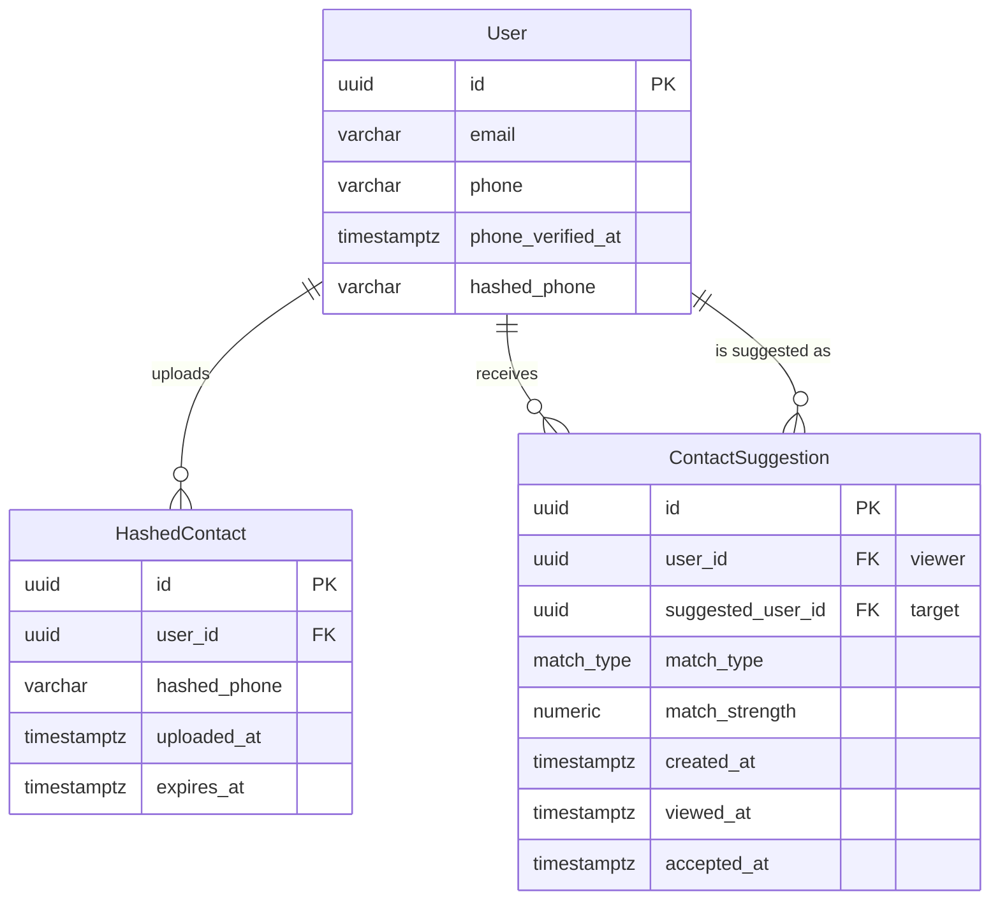

# Phone Contact Discovery Schema & Query Guide

## Overview
This document captures the relational schema, data flow, and operational guidance for the phone-based contact discovery feature. It complements the Prisma definitions in `db/prisma/schema.prisma` and the SQL migration `db/prisma/migrations/20251017_contact_discovery/migration.sql`.

### Design Goals
- **User verification**: Persist a minimal amount of raw phone information to support OTP flows and account recovery.
- **Privacy-preserving matching**: Store only SHA-256 hashes for address-book uploads and cross-user comparisons.
- **Retention minimisation**: Enforce a 30-day time-to-live (TTL) for uploaded contacts while keeping user phone metadata indefinitely.
- **Suggestion lifecycle**: Materialise matches for latency-sensitive clients, but allow clean-up when source data expires or users revoke permission.

## Prisma Schema Summary
Key additions (see inline comments in the schema for details):
- `User.phone` / `User.phoneVerifiedAt` / `User.hashedPhone` with uniqueness and indexed hashed values for matching.
- `HashedContact` table capturing uploads with per-user dedupe and 30-day expiry.
- `ContactSuggestion` table referencing both parties with cascade rules for deletion hygiene.

## Entity-Relationship Diagram


### Constraint & Index Reference
| Object | Constraint / Index | Purpose |
|--------|-------------------|---------|
| `users.phone` | `users_phone_key` (UNIQUE) | Prevent duplicate registrations and enable direct lookups for OTP APIs. |
| `users.hashed_phone` | `idx_users_hashed_phone` (INDEX) | Fast hashed match lookups when other users upload contacts. |
| `hashed_contacts` | `uniq_hashed_contacts_user_phone` (UNIQUE) | Prevent same user from repeatedly uploading the same contact hash. |
| `hashed_contacts.user_id` | `idx_hashed_contacts_user_id` (INDEX) | Efficient dedupe queries and bulk deletions per user. |
| `hashed_contacts.hashed_phone` | `idx_hashed_contacts_hashed_phone` (INDEX) | Cross-user match fan-out. |
| `contact_suggestions` | `uniq_contact_suggestions_pair` (UNIQUE) | Prevent duplicate suggestions per pair. |
| `contact_suggestions.user_id` | `idx_contact_suggestions_user` (INDEX) | Primary retrieval path for in-app suggestions. |
| `contact_suggestions (user_id, match_type)` | `idx_contact_suggestions_user_match_type` (INDEX) | Filtered queries (e.g. only `mutual` suggestions). |

## Migration Plan
The migration file is safe to apply in production with zero downtime.

1. **Transactional deployment**
   - Adds nullable columns (`phone`, `phone_verified_at`, `hashed_phone`) without locking existing reads/writes.
   - Creates supporting unique/index structures using `IF NOT EXISTS` guards.
   - Introduces `match_type` enum before dependent tables to avoid type errors.

2. **New tables**
   - `hashed_contacts` and `contact_suggestions` created with default values and constraints.
   - Defaults ensure future inserts populate timestamps even from legacy services.

3. **Backfill strategy**
   - Step 1: Deploy migration (columns nullable, no data yet).
   - Step 2: Release application logic for phone verification. During rollout, write `phone`, `phone_verified_at`, and `hashed_phone` once OTP completes.
   - Step 3: Optional backfill hashed phone for early adopters by running:
     ```sql
     UPDATE users
     SET hashed_phone = encode(digest(phone, 'sha256'), 'hex')
     WHERE phone IS NOT NULL AND hashed_phone IS NULL;
     ```
     Gate this behind feature flag; run during off-peak hours.
   - Step 4: Enable address-book upload endpoints to populate `hashed_contacts` and job to generate `contact_suggestions`.

4. **Rollback**
   - Drop suggestions table then hashed contacts (no data coupling thanks to cascades).
   - Remove `match_type` enum if unused.
   - Drop added columns; users retain unaffected data snapshot via backups.

## Privacy & Retention Notes
- Raw phone numbers exist only on `users.phone` for OTP, recovery, and un-hashed duplicate detection.
- Uploaded contacts are hashed client-side first; server stores only the SHA-256 string in `hashed_contacts.hashed_phone` and deletes after 30 days via scheduled job:
  ```sql
  DELETE FROM hashed_contacts WHERE expires_at < NOW();
  ```
- Suggestions reference only user IDs and match metadata. When either user deletes their account, cascading foreign keys delete dependent rows, removing traces of the relationship.
- Background job should also remove `contact_suggestions` referencing expired `hashed_contacts` (see cleanup query below).

## Query Patterns & EXPLAIN Guidance
### 1. Deduplicate uploads per user
```sql
-- Prevent duplicates before insert
SELECT 1
FROM hashed_contacts
WHERE user_id = $1 AND hashed_phone = $2;
```
`EXPLAIN ANALYZE` output (with indexes) will show an `Index Only Scan using uniq_hashed_contacts_user_phone` with cost ≈ `0.04..0.05` due to composite unique index.

### 2. Generate matches on upload
```sql
-- Find other users whose hashed phone matches the uploaded contact
SELECT u.id AS suggested_user_id
FROM users u
WHERE u.hashed_phone = $1
  AND u.id <> $2
  AND u.deleted_at IS NULL;
```
Plan should be an `Index Scan using idx_users_hashed_phone` with cost ≈ `0.15..0.20` because the hash lookup is selective.

### 3. Build mutual suggestions
```sql
-- Mutual match when both parties uploaded each other's phone
INSERT INTO contact_suggestions (user_id, suggested_user_id, match_type, match_strength)
SELECT $1, hc.user_id, 'mutual', 1.0
FROM hashed_contacts hc
JOIN users u ON u.id = hc.user_id
WHERE hc.hashed_phone = $2
  AND hc.expires_at > NOW()
ON CONFLICT (user_id, suggested_user_id) DO UPDATE
  SET match_strength = GREATEST(contact_suggestions.match_strength, EXCLUDED.match_strength),
      created_at = NOW();
```
This insert benefits from `idx_hashed_contacts_hashed_phone` for the join side and `uniq_contact_suggestions_pair` for the upsert key.
`EXPLAIN ANALYZE` should show nested loop with index scans on both hashed contacts and suggestions unique constraint.

### 4. Suggestion retrieval for client feed
```sql
SELECT id, suggested_user_id, match_type, match_strength, created_at, viewed_at, accepted_at
FROM contact_suggestions
WHERE user_id = $1
ORDER BY created_at DESC
LIMIT 20;
```
Leveraging `idx_contact_suggestions_user` yields an `Index Scan Backward` plan, keeping order by `created_at` efficient without sort.

### 5. Cleanup cascading suggestions
```sql
-- Remove suggestions when contributing hashes expire
DELETE FROM contact_suggestions cs
USING hashed_contacts hc
WHERE cs.user_id = hc.user_id
  AND hc.expires_at < NOW();
```
When run daily the `idx_hashed_contacts_user_id` allows quick identification of stale suggestions. Combine with the `hashed_contacts` TTL deletion to keep suggestion table compact.

## Operational Considerations
- **Background jobs**: Schedule nightly jobs for TTL cleanup and suggestion regeneration. Ensure they run idempotently.
- **Monitoring**: Track metrics for OTP verification success, number of hashed uploads, suggestion acceptance rate, and TTL deletions.
- **Security**: Rate-limit uploads and keep salts rotation logic in the hashing service. Ensure hashed phone comparisons run in constant-time at the application layer if possible.
- **Data Export**: Add API endpoints to purge user uploads (`DELETE FROM hashed_contacts WHERE user_id = $1`) and suggestions (`DELETE FROM contact_suggestions WHERE user_id = $1 OR suggested_user_id = $1`).

## Flow Summary
1. User enters phone → OTP service validates → `users.phone` + `phone_verified_at` + `hashed_phone` set.
2. Client uploads hashed contacts → rows inserted into `hashed_contacts` (duplicates skipped).
3. Matching job compares uploaded hashes with `users.hashed_phone` to find potential friends.
4. Suggestions written to `contact_suggestions`, respecting `match_type` rules.
5. TTL jobs purge expired hashed contacts and associated suggestions, preserving only necessary metadata.

This schema meets privacy commitments while enabling accurate friend discovery and efficient query patterns for downstream services.
