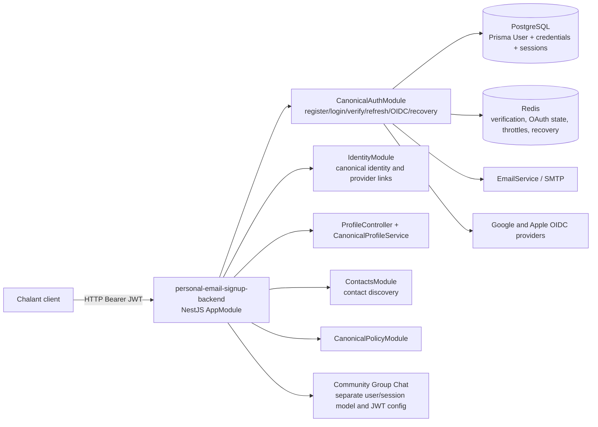

# Chalant Identity: Current Architecture and Integration Contract

**Evidence snapshot:** `main` at `9da0f96fa27636951e947db7c83f54635d3963c5`, fetched from `origin/main` on 2026-10-15; Node `v22.23.1`, npm `10.9.8`. The worktree had one pre-existing untracked file, `CHALANT_LOGIN_USER_PROFILE_REPOSITORY_CONTEXT.md`, preserved during this investigation. This document records source-level inspection only. No application code was changed and no tests, builds, migrations, deployments, databases, live providers, or user records were accessed.

**Evidence labels:** **Verified** means directly visible in this revision's source/config/schema. **Inference** means a consequence inferred from those facts and requiring a targeted test or deployment evidence. **Decision/evidence required** means the repository cannot answer it. Proposed designs are marked **Target** and are not present implementation.

## 1. Executive view

At this revision, this is a **modular NestJS authentication/profile monolith** plus a shared phone-normalization package and an inert/incomplete `login-page-back` service tree. It is not three independently runnable authentication backends. The registered app lives at `services/personal-email-signup-backend`; the `services/login-page-back` directory has files and placeholder trees but no package manifest or active bootstrap. Historical `src/auth` password/OTP controller code exists but is not registered in the active `AppModule`; canonical auth is the registered path. `TermsModule`, OTP, Phase B/C and other modules are imported, but import alone does not prove their features are reachable from canonical user flows.

The canonical `User` row is the identity and profile anchor. `PasswordCredential` and `UserIdentity` model credentials and external provider identities. `IdentitySession` stores a hash of the opaque refresh secret and is also looked up by access-token session ID on every protected request. PostgreSQL owns durable identity/session state; Redis owns short-lived verification, OAuth state, rate-limit and enabled recovery state. SMTP and provider calls are outside PostgreSQL transactions.

The service issues JWTs with `iss=r3-canonical-identity`, `aud=r3-api`; the available Community Group Chat checkout at `b0c7eec49ecb640065a32deda3c6cb8fca827828` configures its user-token validator with `JWT_ISSUER`/`JWT_AUDIENCE` defaults `community-chat`/`community-chat-api`. Both codebases refer to a `JWT_SECRET` setting, but the deployed values, key sharing, user-ID equivalence, and token compatibility are unknown. **No working cross-service authentication integration is established by source.**

## 2. Runtime topology and ownership

**Verified source map:** `src/main.ts:15-76` bootstraps `AppModule`, sets Express `trust proxy` to `1`, configures Helmet/CSP, cookie parsing, CORS and `PORT` (default 3000); it does not set a global prefix. `src/app.module.ts:28-55` registers `CanonicalAuthModule`, `IdentityModule`, `ContactsModule`, `CanonicalPolicyModule`, `TermsModule`, `HealthModule`, and the direct `UsernameController`/`ProfileController`; `UserModule` itself declares no controllers. A global `CustomThrottlerGuard` is also registered. `src/canonical-auth/canonical-auth.module.ts:25-83` binds canonical controllers/services and configures issuer/audience verification. `src/prisma/prisma.module.ts:22-37` creates the Prisma client from `DATABASE_URL_AUTH ?? DATABASE_URL`; the Prisma schema itself names `DATABASE_URL_AUTH` as datasource. `src/redis/redis.module.ts` owns Redis connectivity.

`services/login-page-back/README.md` and its source fragments are not an active deployable here: there is no `package.json`, Nest bootstrap, or root import. `services/login-page-back.empty-backup` is archival-looking material and also not registered. `src/auth/auth.controller.ts`, `src/auth/auth.service.ts`, `src/auth_cc/auth.service.ts`, and compatibility profile methods should not be mistaken for the canonical route handler. The active terms controller is in `auth_cc`, but it is a separate terms path, not the canonical credential endpoint.

### Authority matrix

| Concern | Current authority | Source evidence / boundary |
|---|---|---|
| Stable internal user ID | `User.id` UUID in signup backend | `services/personal-email-signup-backend/prisma/auth.schema.prisma:50-94`; JWT `sub` is canonical user ID. No proof another Chalant DB shares these rows. |
| Email/username and account status | `User` | unique email/username; `isVerified`, `accountStatus`; normalized username optional unique field. No email-change route was found in canonical surface. |
| Password credential | `PasswordCredential.passwordHash`; legacy mirror `User.password` | `auth.schema.prisma:50-59,113-123`; login prefers credential row, falls back to `User.password`. Migration/completion history does not prove all deployed rows are reconciled. |
| Provider identity | `UserIdentity(issuer, subject)` | unique issuer+subject, provider type, user FK; not keyed by email. |
| Refresh session/revocation | `IdentitySession` | refresh token is random opaque value; SHA-256 digest is stored; session row has expiry/revocation. Access guards read session row from PostgreSQL per request. |
| Profile/onboarding | same `User` | profile service selects explicit fields and updates self by principal subject; state checks live in service. |
| Policy acceptance | `User.terms*` plus `PolicyAcceptance` history | two representations coexist; write/acceptance paths and deployed enforcement policy need reconciliation. |
| Contact match identifiers | `HashedContact` and `User.hashedPhone` | phone-normalized deterministic digest; current contact routes fail closed unless v2 HMAC mode is enabled. |
| Community authorization | Community Group Chat owns its local membership, moderation, channel policy | identity authentication must not imply community role, membership, tier or resource permissions. |

### Domain terms

- **Canonical user**: this service's `User` row identified by UUID. The term does not itself imply that every Chalant service currently trusts it.
- **Credential**: a means accepted to authenticate to the canonical user (password hash or provider identity). Current provider identities are Google/Apple; no MFA/passkey model is active here.
- **Identity session**: one durable login session represented by `IdentitySession`; its ID is also the access JWT's `sid`.
- **Provider identity**: stable provider issuer and subject pair. Email is profile data and must not be used as an automatic merge key.
- **Legacy mapping**: source-qualified old-system ID to canonical UUID. Schema support exists; consumers, population and operating process are not established.

## 3. Active HTTP surface

No global prefix is configured. Route inventory from registered controllers:

| Route | Guard / behavior |
|---|---|
| `POST /auth/register`, `/auth/login`, `/auth/verify-email`, `/auth/refresh`, `/auth/logout` | Canonical password lifecycle. Public routes. |
| `POST /auth/logout-current`, `GET /auth/me`, `GET /auth/security/methods`, `DELETE /auth/security/providers/:provider`, `POST /auth/security/password`, `GET /auth/sessions`, `DELETE /auth/sessions/:id`, `POST /auth/sessions/revoke-all` | JWT guard; principal/session comes from verified token, not body ID. Sensitive credential/provider operations rely on a “recent” session check. |
| `GET /auth/google`, `/auth/google/callback`, `/auth/google/link`; `GET /auth/apple`, `POST /auth/apple/callback`, `/auth/apple/link` | OIDC sign-in/link; feature/config gated. |
| `POST /auth/recovery/request`, `/auth/recovery/reset` | Recovery service is disabled by default. |
| `GET /profile/me`, `PATCH /profile/me`, `GET/PATCH /profile/onboarding`, `POST /profile/pronouns`, `POST /profile/image` | Controller-level JWT guard; self subject is taken from principal. Profile DTO validation is explicitly installed. |
| `PATCH /profile/policy/accept` | Canonical policy module; authenticated contract. |
| `POST /contacts/upload`, `GET /contacts/suggestions`, `DELETE /contacts`, `GET /contacts/privacy` | JWT + contact policy; uploads additionally rate-limited and validate DTO. HMAC v2 configuration gates secure discovery. |
| `/health`, `/health/live`, `/health/ready` | readiness includes dependencies; liveness does not. |
| `POST /auth/terms/accept`, `/auth/terms/status` | `TermsController` is registered by `TermsModule` and uses `JwtAuthGuard`; it passes the principal subject to the terms service. |
| `GET /username/available`, `POST /username` | `UsernameController` is registered directly by `AppModule`; availability is public and throttled, set is JWT-guarded. |

**Unregistered controller files are not active routes:** `UserModule` has `controllers: []`; `UserController` and `UsernameApiController` are not registered. `PoliciesController` (legacy `/api/policies/accept`) is also not registered in a module. The old `src/auth/AuthController` is not registered by active `AppModule`; do not report those file-level routes as reachable. Their unfinished authorization behavior remains relevant only if a later module registers them.

The canonical auth controller receives TypeScript interface types for registration/login and uses `@Body()` directly; `main.ts` does not install a global `ValidationPipe`. The recovery controller uses decorated DTO classes but no controller-local pipe is visible. This is a **verified validation configuration gap to investigate**: static TypeScript types are erased, so assess actual malformed/oversized inputs at runtime and set explicit DTO/pipe contracts before relying on validation. Profile and contact controllers install pipes locally.

## 4. Lifecycle and state ownership

### Password registration and verification

`CanonicalAuthService.register` (`services/personal-email-signup-backend/src/canonical-auth/canonical-auth.service.ts:67-117`) normalizes email to lower case, checks required text, runs password policy, then transactionally creates `User` and `PasswordCredential`, with active but unverified account. It then creates a random 32-byte verification token, stores user ID in Redis under a SHA-256-keyed token with default 24-hour TTL, and sends SMTP only if `EMAIL_DELIVERY_ENABLED` is true (default false). It returns `verification_required`; no session is issued. The Postgres transaction ends before Redis and SMTP. Redis/email failure therefore leaves a durable unverified account; if delivery fails after Redis write, the token may still work if the client obtains it by another path. This is a partial-commit scenario, not a reproduced production outage.

Verification (`canonical-auth.service.ts:152-165`) uses Redis `GETDEL`, then updates `User.isVerified=true`. Redis consumption and the database update cannot be atomic: if SQL fails after `GETDEL`, the token is lost while the user remains unverified. Repeat-safe durable challenge state or a transaction/outbox design should be evaluated; simply making tokens multi-use would weaken one-time semantics.

### Password login and token model

Login selects user and both password representations; it verifies `PasswordCredential.passwordHash ?? User.password`, rejects inactive and unverified accounts, then creates a session. `verifyPassword` supports bcrypt and Argon2 encoded hashes, while active `PasswordPolicyService` currently hashes with bcrypt cost 12. Account-existence and wrong-password responses are generic, but the “email verification required” response differs after a correct password, which may disclose verification state to someone who already knows a candidate password; measure threat and product impact.

Access token: signed with `JWT_SECRET`; 15 minutes; `iss=r3-canonical-identity`, `aud=r3-api`, `typ=canonical-access`, `sub=user UUID`, `sid=IdentitySession.id`. Refresh token: random 48-byte base64url opaque secret, seven-day row expiry, only SHA-256 hash stored. Tokens are returned in JSON. Cookie parsing/CORS credentials do not establish cookie-based auth; the client storage/transport lifecycle is external and unverified.

Refresh (`canonical-auth.service.ts:168-204`) checks row hash/revocation/expiry, then transactionally marks the old row revoked and checks user is active + verified. After that transaction commits, `issueSession()` inserts a new row and signs a JWT. Thus a refresh race uses conditional update to allow at most one winner, but a process/database failure between revoke commit and new row creation can strand a valid client with no refresh credential. Lost successful response also leaves old token consumed. Each refresh issues a *new session ID*, so access JWTs from the previous session fail the live session lookup immediately, even if their `exp` has not elapsed. Client retry behavior and concurrent multi-tab semantics require explicit contract/testing.

### Social identity and linking

Google uses random state, nonce and PKCE S256 verifier/challenge in Redis; callback consumes state once, exchanges code, verifies ID token through Google library and checks issuer, audience, nonce, expiry, email presence and `email_verified`. Apple uses random state+nonce and `form_post`, code exchange, ID token verification and checks issuer/audience/nonce/expiry. Apple callback also validates a supplied front-channel ID token when present. Both store provider links keyed by issuer+subject. Sign-in does not merge on email collision: it returns an explicit-link conflict. New provider users are created transactionally with verified email and provider identity.

Link flows call `requireRecentSession` (`canonical-auth.service.ts:256-278`) at initiation and callback, but that method checks only active session and `createdAt` within 15 minutes. It does not verify recent password/provider reauthentication. Linking passes `reauthenticated: true` to the identity service based on that timestamp check. See S-02 in Document Two. No provider unlink is allowed if it would leave zero password/provider methods, but concurrent unlink behavior needs an adversarial test.

### Recovery, profile, onboarding, account state

Recovery is available only when `CANONICAL_RECOVERY_ENABLED=true` (default false). Request rate-limits by hash of normalized email and returns a generic message for unknown, inactive, unverified or provider-only accounts; eligible users receive a purpose-bound random token in Redis, 15-minute default TTL, email delivery. Reset `GETDEL`s the token before loading/updating SQL, updates both password representations and revokes all sessions in one transaction. A policy rejection also happens after token deletion, so a mistyped/weak proposed password consumes the recovery credential. This is recoverability/failure-flow behavior, not an authentication bypass.

Profile routes derive subject from `request.user.subject`, select an allowlist and update only the user's own row. They include email and policy timestamps and thus are authenticated private-profile responses, not suitable as public profile contracts. Onboarding allows `NOT_STARTED -> IN_PROGRESS`, rejects `NOT_STARTED -> COMPLETE`, and does not allow leaving `COMPLETE`; user-submitted status is the transition request. Profile image is a URL pointer (HTTP/HTTPS validation in DTO), not uploaded or managed media. Account status enum includes ACTIVE/SUSPENDED/DISABLED; login, refresh and principal lookup enforce ACTIVE. There is no canonical account-status administration route or account delete/export/email-change route found.

## 5. Credential, schema, and migration model

`services/personal-email-signup-backend/prisma/auth.schema.prisma` is the active schema configured by package scripts. `User.password` is nullable legacy compatibility; `PasswordCredential.userId` is unique. `IdentitySession.sessionHash` is unique. `UserIdentity` unique `(issuer, subject)` prevents one provider identity being attached to multiple users under concurrency. `LegacyIdentityMapping` unique `(source, originalId)` prevents duplicate source IDs. Foreign keys cascade on user deletion for these canonical child records.

`RefreshToken` remains as a separate legacy table/model and is not the session model used by `CanonicalAuthService`. `UserIdentity`, password credential and session models are the canonical path; overlap with legacy rows is a migration/compatibility concern, not proof of active parallel authentication. `PolicyAcceptance` history plus fields on `User` duplicates acceptance state. Check data reconciliation, policy version semantics and all writers before choosing a single authority.

Migration history includes multiple older init migrations followed by canonical migrations dated 2026-10-09/10. Recent 2026-10-15 commits repair migration order, UUID FK handling, and make one index migration transactional. No migration was applied here; the migration tree's correctness on a real historical database, backup/restore path and deploy lock behavior remain unverified.

## 6. Contact discovery and profile privacy

Normalization is delegated through `PhoneNormalizationPort` to shared `@auth/phone-normalization`; hashing through `PhoneHashingPort`. `CONTACT_HASH_MODE` and `.env.example` default to `sha256-v1`; the active upload service explicitly throws unless mode is `hmac-sha256-v2`, which requires `CONTACT_HMAC_KEY` (minimum length enforced by adapter). That explains “configured default” versus active endpoint: sample defaults preserve historical hash compatibility, but active endpoints fail closed. Plain SHA-256 of normalized phone values allows offline enumeration if table data leaks because phone numbers have low entropy; HMAC changes that attacker model while making all writers/readers depend on secret-key consistency and planned reindex/rotation. There is no safe key rotation from a digest alone; client re-upload or a controlled source-number reindex is needed.

Contact uploads normalize, hash and persist contact digests with default 30-day expiry and generate suggestions inside a PostgreSQL transaction. Owner deletion and opt-out paths exist. Matching filters target `allowContactDiscovery` and block relationships in code; connection filtering includes a repository stub that returns an empty set, so its documented “existing connections excluded” behavior is not established by that method. User profile includes the discovery preference. Assess exact candidate visibility, timing and abuse limits with real fixture tests; there is no raw contact storage requirement proven by this code alone.

## 7. Chalant ecosystem integration

### What can be established

The canonical service signs `sub` as its User UUID with fixed issuer/audience and symmetric `JWT_SECRET`. It does a live database session and active-user lookup itself on every protected route. There is no JWKS endpoint, asymmetric signing-key distribution, shared session introspection endpoint, token exchange contract or cross-service revocation mechanism in this repo. `LegacyIdentityMapping` provides schema capacity, but no migration importer/consumer contract is demonstrated.

### Read-only consumer comparison

The connected Community Group Chat checkout is `Community-group-chat`, branch `master`, SHA `b0c7eec49ecb640065a32deda3c6cb8fca827828` when inspected; clean status at that time. Its `libs/auth/src/auth.module.ts:44-63` configures JWT verification from `JWT_SECRET` and defaults issuer/audience to `community-chat` and `community-chat-api`; `libs/auth/src/jwt.service.ts:77-100` verifies signature then requires those exact claims. Its own auth code issues role/scope-bearing tokens and the consumer maintains its own local user/membership domain. No canonical issuer/audience acceptance or key relationship with this service was found in that checkout. This comparison is source-level only; deployed configuration may differ. The services' use of a similarly named environment variable does not prove they share a secret or trust relation.

### Target contract (proposal)

1. Identity service is authoritative for immutable UUID subject and authentication events. Community remains authoritative for memberships, roles, bans, tier, community/channel policies, and moderation.
2. Specify a versioned token profile with issuer, audience per resource server, `sub`, `iat`, `exp`, `jti`, `sid`/session semantics, authentication method/assurance, key ID, scope/claim ownership, and explicit no-PII/minimal-claims rules. Consumer verifies identity only; it independently authorizes the requested Community action.
3. Prefer asymmetric signing with published, authenticated JWKS and `kid` overlap for rotation, so a verifier has no token-minting key. Alternatively use protected introspection with short cache TTL bound to documented revocation latency. Symmetric signing is acceptable only with an explicit shared trust domain and acknowledgement that every key holder can mint tokens.
4. Define logout/suspension/deletion propagation and maximum stale authorization window. Options include short-lived access tokens plus introspection/event revocation, or local mapping/status synchronization with replay-safe signed events. No one option can be selected without availability and revocation requirements.
5. Migrate users only with owner-approved mapping evidence. Never merge accounts on email or username equality. Enforce a unique source-qualified mapping, preserve provenance and allow conflict/manual resolution.

### External evidence required

- Deployed issuer/audience/algorithm/key IDs, key custody and rotation, actual client token storage, TLS/proxy topology and service-specific env values.
- Community's intended identity source, legacy user-ID mappings and auth middleware acceptance contract.
- Product/security decision for revocation latency after logout/suspension/account deletion and whether identity provider proof counts as recent authentication.
- Owner-approved privacy retention, public profile projection and contact discovery semantics.

## 8. Architecture assessment

**Strengths verified:** one clear canonical auth route/module; explicit identity repository port; provider identities use issuer+subject; DB uniqueness constraints protect identity/session tokens; user principal is derived server-side; session revocation is checked on guarded access; profile selects explicit fields; sensitive state updates mostly group relational writes in Prisma transactions; OIDC state is one-time and PKCE is used for Google.

**Friction verified:** canonical auth service coordinates validation, password compatibility, Redis, SQL, SMTP, session and JWT; mutable state crosses Redis/PostgreSQL/SMTP without durable workflow state; legacy and canonical auth artifacts share `auth` naming; config includes many fields/defaults whose active consumer must be traced; the repository README/module comments are stale in places; `IdentityService` expresses fresh auth as a caller-provided boolean; profile controller contains undecorated legacy methods alongside active route methods; the identity data model has intentional-looking dual representations but no complete reconciliation record in source.

**Target architecture:** retain a modular monolith unless deployment/team ownership or measured load requires another process. Keep small external seams at `IdentityRepositoryPort`, provider clients, mail transport, Redis challenge store and token verifier. Deepen the lifecycle orchestration behind explicit operation interfaces that state idempotency, transaction, retry and failure semantics. Separate authentication proof time from session creation time. Use durable verification/recovery challenge state/outbox if delivery/recoverability guarantees demand it. Public profile should be a different narrow projection and permission contract.

## 9. Standards checked

Checked 2026-10-15 against primary sources: [NIST SP 800-63B-4, Authentication and Authenticator Management](https://pages.nist.gov/800-63-4/sp800-63b.html), especially §§3.1.1 (passwords), 3.2.2 (rate limiting), 4.2 (recovery) and 5.2 (reauthentication); the current suite supersedes 800-63-3. If Chalant selected NIST AAL alignment, compare its default 8-character single-factor minimum and composition rules with §3.1.1's single-factor 15-character minimum and prohibition on composition rules. This is not asserted as a defect unless NIST alignment is an approved target. [OWASP ASVS 5.0.0](https://github.com/OWASP/ASVS/releases/tag/v5.0.0) is the latest stable release found; select the relevant level and requirements before claiming conformance. Also reviewed [OWASP Authentication Cheat Sheet](https://cheatsheetseries.owasp.org/cheatsheets/Authentication_Cheat_Sheet.html) and [Session Management Cheat Sheet](https://cheatsheetseries.owasp.org/cheatsheets/Session_Management_Cheat_Sheet.html); [RFC 9700 OAuth 2.0 Security BCP](https://www.rfc-editor.org/rfc/rfc9700.html), especially §§2.1.1 and 4.5 on redirect/PKCE/code injection; and [OpenID Connect Core 1.0](https://openid.net/specs/openid-connect-core-1_0-36.html), including ID-token issuer/audience/nonce validation. These are evaluation references, not evidence of current certification or legal compliance.

## 10. Architecture handoff

Start next with `src/app.module.ts`, `src/main.ts`, `src/canonical-auth/canonical-auth.service.ts`, `src/auth/jwt-auth.guard.ts`, `src/canonical-auth/google-auth.service.ts`, `src/canonical-auth/apple-auth.service.ts`, `src/canonical-auth/canonical-recovery.service.ts`, `src/identity/identity.service.ts`, `src/user/canonical-profile.service.ts`, `src/contacts/contacts.service.ts`, `src/contacts/canonical-contact-adapters.ts`, `prisma/auth.schema.prisma` and every migration from the first init through `20261010120000_canonical_policy_acceptance`.

Resolve in this order: (1) refresh transaction/failure behavior and reauthentication semantics (S-01/S-02), (2) concurrent credential unlink and Redis/SQL one-time challenge recovery semantics (S-03/S-04), (3) deployed service-to-service token contract and key authority (I-01), (4) schema/legacy credential and policy-state reconciliation plus migration upgrade proof (D-01), (5) runtime DTO validation, proxy/CORS and rate-limit trust assumptions, (6) HMAC reindex/key lifecycle and contact discovery privacy, (7) actual CI/deployment/observability/backup evidence. Document Two contains security invariants and adversarial scenarios; Document Three contains gated engineering work and closure criteria.
