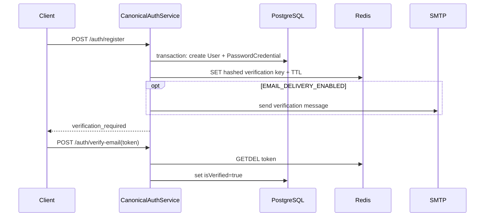

# Chalant Identity: Security, Lifecycle, and Failure Analysis

**Evidence snapshot:** `main` `9da0f96fa27636951e947db7c83f54635d3963c5`, 2026-10-15. Read alongside [Document One](from-hara-01-identity-architecture.md) for system ownership and route context. Source observations below are not penetration-test results. Findings are classified as **Observed behavior** (direct code path), **Failure hypothesis** (plausible interleaving/outage not executed), **Reproduced in isolation**, or **Decision needed**. No production configuration, real account, provider, production database or email service was used; §1 below corrects the earlier source-only boundary.

## 1. Assets, actors, and trust boundaries

**Scope correction:** the opening paragraph described the earlier source-only pass. V2 also ran safe local checks and a migration only against a newly created disposable Postgres container; no target, historical or production database was accessed. Document Three records the exact boundaries and results.

**Updated evidence boundary (2026-10-15):** application source/configuration is 9da0f96fa27636951e947db7c83f54635d3963c5; local docs-only HEAD is ff339f4e02a5e5bac175bb00fac3a12109e4d19d. The migration failure was reproduced in a new disposable Postgres 15 container without a volume. Current GitHub Actions logs were inspected. No production configuration, real account, provider, production database or email service was used. Details and exact CI results are in Document Three.

**Assets:** canonical UUID and verified email; password hashes (canonical plus legacy mirror); provider issuer/subject bindings; access/refresh credentials and session status; account/profile/privacy fields; Redis one-time state; contact-derived relationship suggestions; JWT signing secret and Apple client-signing key; identity-to-community mapping.

**Actors:** unauthenticated registrant/login client; authenticated account owner; attacker with stolen password/refresh/access token; attacker controlling browser/callback parameters; malicious or misconfigured downstream service; compromised app instance/secret; DB/Redis/mail/provider outage; privileged operator and backup reader.

**Trust boundaries:** browser to Nest HTTP (Bearer token), Nest to PostgreSQL (identity/session authority), Nest to Redis (short-lived challenge authority), Nest to SMTP, Nest to Google/Apple OIDC, and signup identity to Community Group Chat. HTTP forwarded-IP trust relies on Express `trust proxy=1`. CORS, `X-Device-Id`, `X-Tenant-Id`, callback origins and frontend token storage are not fully known from source.

## 2. Security invariants

| ID | Invariant | Existing enforcement | Gap / proof needed |
|---|---|---|---|
| INV-01 | One canonical UUID identifies one account; email/username uniqueness is database-enforced. | Unique schema constraints on User fields. | Verify case normalization, historical collisions and all writers/imports against deployed DB. |
| INV-02 | External identity is `(trusted issuer, stable subject)`, never email-only merge. | OIDC verification then unique `(issuer, subject)`; email collision requires explicit link. | Test provider issuer/audience/key rollover and parallel first-login conflicts. |
| INV-03 | Only the account owner principal may mutate that account. | Guard validates JWT, session and active user; profile derives subject from `request.user.subject`. | Audit all registered `/users`, username, policy and terms handlers for `:id` ownership/admin enforcement. |
| INV-04 | Refresh credential is single use; only one concurrent refresh succeeds. | Conditional `updateMany` on unrevoked, unexpired session inside transaction. | Successor insert occurs after commit; prove crash/retry recovery, replay response and retry semantics. |
| INV-05 | Revoked/expired/inactive account cannot use protected access. | Guard checks JWT signature/claims, DB session and expiry; principal loader requires ACTIVE. | Verify all protected modules use this guard and no alternate auth bypass; measure DB availability and load. |
| INV-06 | One-time verification/recovery/OIDC state cannot be replayed. | Redis `GETDEL`; OIDC state has random values and TTL; Google includes nonce+PKCE. | SQL operation after `GETDEL` may fail; distinguish at-most-once from recoverable completion. |
| INV-07 | Sensitive account changes require fresh proof, not just possession of a long-lived token. | `requireRecentSession` checks active row and session `createdAt` within 15 minutes. | It does not record or validate a new credential/provider challenge; recent refresh creates a fresh row. Current behavior does not prove reauthentication. |
| INV-08 | Account cannot be left without a usable credential due to unlinking. | Unlink transaction counts password/provider methods and rejects count <= 1. | Two simultaneous unlinks may each observe two and remove different methods; add serialized/constraint-backed proof. |
| INV-09 | Contact matching cannot be computed from a low-entropy phone digest without the server key. | Active upload service fails closed unless HMAC v2; adapter validates configured key. | Deployed mode/key, old digest coexistence, rotation/reindex and privacy deletion need operational evidence. |
| INV-10 | Identity authentication is distinct from Community authorization. | Separate Community domain owns local role/membership models. | No agreed cross-service token/trust contract or current deployment integration evidence. |

## 3. State transitions and operation boundaries

### Registration / verification

Current account states are represented mostly by `isVerified` and `accountStatus`; there is no durable verification challenge model in the Prisma schema. A Redis outage after the DB commit leaves an unverified account without a challenge from this request. An SMTP exception occurs after Redis SET and DB commit; the user may retry registration but hits the unique constraint, while the one-time token is not returned. `EMAIL_DELIVERY_ENABLED=false` by default means the repo can issue tokens but has no email delivery path in this config. Do not label this a production bug until deployed feature configuration and client recovery path are checked.

`GETDEL` makes challenge consumption atomic inside Redis, but not with PostgreSQL. If verification's `User.update` fails after deletion, re-use is impossible. On recovery, the token is also removed before eligibility, strength policy and transactional password update; weak password typo or transient DB failure consumes it. A durable challenge status transition in the same SQL transaction as the user change, or a carefully designed idempotent completion protocol, could preserve single use and recoverability. An outbox helps reliable mail delivery but does not by itself atomically consume a Redis token.

### Login / sessions / logout

Password login verifies stored hash, then checks ACTIVE and verified, then inserts session and signs access JWT. The DB session is inserted before checking JWT secret; if signing configuration is absent at runtime, session row can be orphaned. Config validation requires a JWT secret, so reaching this path without it should be blocked at startup, but failure injection is still useful. Logout with refresh secret revokes matching session if present; logout-current and other session revocation use verified `sub` and `sid`. Revoke-all transactionality is a single `updateMany`; access JWTs then fail because guard queries session state.

Every protected HTTP request verifies JWT and reads `IdentitySession`; then loads the principal and account status from Postgres. This gives prompt session/account revocation in the single service at the cost of DB dependency and query load per request. Local cache can weaken the revocation promise; any cache proposal must state a maximum revocation lag and test stale SUSPENDED/REVOKED cases.

### Refresh rotation

**S-01, high correctness priority — split rotation / successor creation. Observed behavior:** `refresh()` marks prior row revoked in a Prisma transaction, commits, then calls `issueSession()` which inserts replacement session and signs JWT (canonical auth service lines 168-204, 410-439). Unique/conditional state prevents two winners at consumption. **Failure hypothesis:** crash, DB failure, or signing failure after commit leaves old token unusable and no delivered successor. Response loss has the same client-visible effect. Refresh also creates a new session ID, causing prior access tokens referencing old `sid` to fail immediately. **Required test:** block/fail immediately after old-row revoke; race N identical requests; drop successful response; assert exactly one lineage/usable successor or explicit documented reauthentication recovery, old token replay denial, prior access JWT behavior, and account status enforcement. **Target:** make consume+successor row one DB transaction with conditional consume and new row creation; mint the response only after commit. Response-loss recovery needs an explicit idempotency/recovery design (e.g. bounded rotation family/grace protocol with theft detection) and cannot be solved by simply accepting the old bearer indefinitely.

### Recent authentication and account linking

**S-02, high security priority — session age is being treated as reauthentication. Observed behavior:** `requireRecentSession` checks `createdAt <= 15m`, account ACTIVE, session alive; it does not validate credentials/provider proof or an `auth_time` claim. It gates set-password, unlink and OIDC link begin/callback. A refreshed session is newly inserted, so refresh can make an old authentication look recent. Identity service receives a boolean `reauthenticated: true` from that check. **Risk:** a stolen valid refresh credential can refresh and then satisfy this check for account-security changes; this is a concrete semantic mismatch, not proof of a deployed exploit. **Required test:** age the original auth, refresh, then call every sensitive path; verify whether product expects rejection. Add evidence timestamp/method to session and a deliberate step-up operation bound to the target user/session/provider transaction. Re-check at callback and consume challenge state once.

`UserIdentity` unique issuer+subject handles competing links to different users. However unlink's method count and delete are in a transaction without evident user-row lock/serializable isolation; two different provider unlinks can each observe count 2 and both succeed, leaving zero. **S-03, concurrency hypothesis:** force simultaneous unlinks with a passwordless two-provider account; assert at least one remains. Candidate fix is serialize on the User row / serializable retry or enforce credential-method invariant by a DB design that covers all credential types. Add set-password/unlink overlap coverage too.

### OIDC provider flows

Google creates 32-byte state, nonce, 48-byte verifier and S256 challenge, saves state for 600s by default, then atomically consumes it. The Google library verifies ID token signature; code additionally checks canonical issuer string, configured audience membership, nonce, expiration and verified email. Apple creates state/nonce and uses response mode `form_post`; code exchanges authorization code, verifies returned ID token, validates issuer/audience/nonce/expiry, and when front-channel `id_token` exists checks it matches code result. Apple client signing key may be inline or file; registered callback must be HTTPS and non-local. Provider credential availability, registered redirects and key rotation are environmental unknowns.

`RFC 9700` recommends exact redirect matching and PKCE for public clients and recommends PKCE for confidential clients; Google code uses PKCE S256, Apple flow does not visibly use PKCE. Determine Apple SDK/provider support and threat model before classifying that difference. Verify provider SDK/library checks algorithm/key signature, token `iat`/`azp` when multiple audiences apply, and nonce replay under provider rotation. State is consumed before remote exchange; a provider outage or invalid callback burns that login transaction, an availability/retry tradeoff. Must never fall back to email-only linking. Callback URLs, state leakage in logs/referrers and redirect handling require live/browser config review.

### Account-state change

Login and refresh reject non-ACTIVE, while every protected request reloads principal and thus denies after SUSPENDED/DISABLED. These are useful local guarantees. There is no account-status change controller or event bridge in the inspected canonical surface; propagation to Community is unresolved. Test status transition against outstanding access/refresh tokens, each OIDC provider and separately stored consumer authorization. Account deletion has no API despite relational cascades; define legal holds, recovery/audit dependencies and downstream erasure before adding.

## 4. Security finding register

| ID | Finding class | Evidence and effect | What is not proven | Verification / improvement direction |
|---|---|---|---|---|
| S-01 | Observed split commit; outage failure hypothesis | `services/personal-email-signup-backend/src/canonical-auth/canonical-auth.service.ts:168-204,410-439` revokes old row in a transaction, then calls `issueSession()` afterward. Potential lockout after transient error/lost response. | No injected failure or live occurrence. | Deterministic fault-injection integration test; transactional consume+insert, then designed retry-family behavior. |
| S-02 | Observed semantic gap | `canonical-auth.service.ts:256-278,325-398`; Google/Apple link entrypoints call this check. “Recent” means row creation time; refresh creates a new row; no credential proof timestamp. | Exploitability depends on refresh-token theft and product requirement. | Step-up authentication flow and adversarial stolen-refresh scenario. |
| S-03 | Concurrency hypothesis | `canonical-auth.service.ts:325-351` counts methods then deletes; concurrent distinct provider removals can race last-method count. | Not reproduced; exact DB isolation behavior not measured. | Parallel DB integration test; lock/serializable invariant. |
| S-04 | Observed multi-store token consumption | `canonical-auth.service.ts:152-165` and `canonical-recovery.service.ts:90-148` use Redis GETDEL before DB update/policy. Failures can permanently consume token. | No Redis/DB error injection performed. | Inject failure at every boundary; define idempotent durable challenge state. |
| S-05 | Observed validation gap candidate | `canonical-auth.types.ts:3-12`, `canonical-auth.controller.ts:25-36`, `canonical-recovery.controller.ts:5-33`, and `src/main.ts:15-76`: register/login use interface types; bootstrap has no global pipe; recovery decorators have no visible local pipe. | Nest runtime test not run; service validates some fields manually. | Test malformed types, huge body, extra properties and limits; install per-controller DTO validation and body size limits. |
| S-06 | Observed token compatibility gap | Identity JWT issuer/audience differ from Community defaults; signup uses JWT_SECRET; Community reads same variable name but separate defaults. | Environment secret value/config may align via overrides; deployments unknown. | Obtain deployed safe config metadata and explicit consumer verifier test; define key ownership. |
| S-07 | Observed symmetric key trust consequence | JWT uses shared-secret HMAC configuration; no JWKS/key-discovery implementation found. Any verifier given signing secret can mint tokens. | Whether secret is shared/distributed today is unknown. | Inventory custodians; prefer asymmetric signature + JWKS or protected introspection if independent resource servers need verify-only authority. |
| S-08 | Observed contact hash mode split | `.env.example` defaults SHA-256; active contact methods require HMAC v2; adapter requires secret. | Runtime may already use HMAC and data may be reindexed. | Confirm configured mode and key version, measure hash population, approved reupload/reindex, old digest deletion and rollback plan. |
| S-09 | Config trust hypothesis | Express trusts one proxy hop; custom limiter also reads first `X-Forwarded-For` itself; CORS defaults `*` while credentials true; authentication uses Bearer, not cookie. | Actual reverse proxy chain/origin policy unknown; browser CORS behavior depends on requests. | Verify ingress topology and spoofed forwarded headers; pin CORS origins, test credentialed preflight, ensure only proxy overwrites forwarded fields. |
| S-10 | Password policy tradeoff | Current policy hashes bcrypt cost 12; signup/reset/set password pass `skipHIBP: true`; separate breach checker exists but is bypassed on these canonical paths. Login supports bcrypt/Argon2 and prefers credential table. | This does not prove weak passwords accepted; local zxcvbn checks still run; environment policy decision absent. | Measure hash CPU/latency at concurrency; decide breached-password policy; test legacy/canonical mismatch and upgrade path; avoid network lookup for every request. |
| S-11 | Enumeration/rate limit review | Login differentiates invalid credentials from correct password + unverified account. `src/security/custom-throttler.guard.ts:155-162` derives user bucket from `req.user?.id`, while canonical principal is `subject`; the global guard also runs before route guards populate the principal. Thus the per-user dimension appears to collapse to a shared anonymous key on guarded canonical routes. | Effective endpoint limits, keys, trusted IP and bypass behavior not integration-tested; verify the user-dimension observation with Nest guard-order integration evidence. | Timing/status/body tests for known/unknown/verified states; prove each intended per-IP/device/user bucket gets the correct key after guard order; proxy spoof test; add endpoint limits for expensive paths. |
| S-12 | Contact privacy/abuse | HMAC reduces offline inversion, matching endpoint allows discovery; user opt-out, expiry and delete routes exist. Some repo methods are placeholders (e.g. existing connections returns empty set). | No privacy review or production candidate-result exercise. | Enumerate all returned fields and block/opt-out semantics; test retention cleanup and delete propagation; measure chosen-contact probing and upload abuse. |
| S-13 | Availability coupling | Access guard checks Postgres on every protected request; Redis and Postgres used for separate state; email/provider calls external. | No load or outage measurement. | Define availability/revocation SLO; pool/timeout/circuit behavior; avoid introducing stale auth cache without a revocation budget. |
| S-14 | Schema/migration operational uncertainty | Prisma schema has multiple legacy models and old + canonical migration chain; recent commits alter UUID/FK migration history. | No actual target DB status/backup/restore or upgrade run. | Fresh and production-like upgrade rehearsals, row/constraint audit, rollback/forward-fix plan, lock and transaction inspection. |

The detailed notes below refine S-05, S-09, S-11 and S-12 based on the current source trace, and upgrade S-14 from general uncertainty to a reproduced clean-install blocker. They do not change the limits stated in the evidence column.

### Detailed lifecycle design review: S-01 to S-04

**S-01 — refresh rotation needs two separate contracts.** Today refresh uses a conditional update so concurrent callers cannot both consume the same row. But it commits that revoke before inserting a successor session (canonical-auth.service.ts:168-204); issueSession inserts the new row before checking/signing with JWT_SECRET (:410-439). This creates two server-side failure windows: failure between old-token consume and new-row insert strands the caller; signing failure after insert leaves an undisclosed refresh secret whose row cannot be used by the client. A lost HTTP response after successful signing has the same user-visible result, even if all SQL was correct. These are source-proven orderings; outage occurrence was not observed.

| Rotation design | Server crash atomicity | Replay detection | Access-token/session behavior | Response loss / multi-tab behavior | Tradeoff |
|---|---|---|---|---|---|
| Current: revoke old session, then create a new session | Fails across the SQL commit boundary | Old token rejected; conditional update gives one winner | New sid means old access tokens stop working as soon as their session row is revoked | Lost response leaves client without refresh; simultaneous tabs yield one winner and a failing loser | Simplest storage; availability and retry semantics are poor |
| Same session row, overwrite refresh digest | A single transaction can replace digest atomically | Prior digest is forgotten, so replay cannot be distinguished from random invalid token unless extra history is added | Stable sid preserves other access tokens until their own expiry/revocation | One concurrent caller wins; lost response still loses the only new secret | Minimal schema change, weak rotation lineage |
| Stable logical session plus separate refresh-token family/credential rows | Consume and insert successor in one DB transaction | Retain consumed-token lineage; replay can revoke the family/session | Stable session ID preserves access token semantics; revoke session invalidates all | Parallel old-token calls can be classified; lost response still needs a client policy | Best separation of logical login from rotating secret; requires schema, migration and explicit replay policy |
| Idempotent response replay | SQL transaction plus encrypted, bounded response cache keyed by client request ID | Can return the same successor to an authenticated retry | Depends on underlying stable-session choice | Addresses response loss only if client persists/reuses an idempotency key; stolen key risks response replay | More state, key management and short retention; do not store bearer response plaintext |

**Recommended target, subject to client-owner decision:** represent a durable logical IdentitySession separately from one-time refresh credentials in a family. In one transaction conditionally consume the current credential and insert its successor; retain used credential digests, replacement IDs, expiry and family status for replay detection. Keep access JWT sid stable across refresh so rotation does not unexpectedly revoke unrelated in-flight requests. A consumed-token replay should revoke the family/session and emit a security event, subject to a narrowly bounded policy for parallel mobile requests. A database transaction cannot recover a random successor secret after the response is lost. Default to clear reauthentication on this rare event; add idempotent retry only if client requirements justify encrypted short-lived response storage and a client-held idempotency key. Decide whether concurrent tab losers trigger family revocation before implementation. Tests must cover transaction rollback, post-commit signing failure, dropped response, same-token N-way race, replay after successor use, logout-current, logout-all, account suspension, and old access-token validity.

**S-02 — session freshness and proof freshness are distinct data.** requireRecentSession uses IdentitySession.createdAt within 15 minutes and current ACTIVE state (canonical-auth.service.ts:256-278). Refresh creates a new row, so this timestamp can become recent without the user proving a password or provider credential. It gates provider unlink/password setup; Google/Apple linking also checks at initiation and callback. IdentityService receives a caller-supplied reauthenticated=true based on this timestamp. Target design: a server-verified step-up event with auth_time, amr/assurance, one-time random challenge, subject, stable session ID, intended operation/provider, short expiry and consumed state. Password users re-enter password; provider users complete provider authentication with nonce and provider-supported max_age/equivalent proof, then verify provider auth_time where available. Bind and consume the challenge at callback; do not trust a client boolean or old JWT claim alone. Product owners must set which operations require which proof and how long proof remains valid. Reauthentication must not be implied by refreshing.

**S-03 — aggregate credential invariant requires a shared lock.** A UserIdentity unique key cannot enforce “at least one usable method remains,” because password and multiple providers span rows. Lock the canonical user row before reading/counting and mutating any credential representation; enforce the same lock order for link, unlink, password creation/change/recovery. If serializable isolation is chosen instead, retries must be bounded and surfaced as a safe retry, not silent success. Verify parallel requests against a database, including password insertion racing the last provider unlink and two distinct provider unlinks.

**S-04 — Redis token one-time use and SQL mutation do not compose atomically.** Verification does GETDEL before setting isVerified; recovery does GETDEL before account/policy validation and before password/session SQL (canonical-recovery.service.ts:90-148). A crash or transient SQL/policy error consumes a valid token. Recovery currently consumes a token even when the proposed password violates policy. A transaction cannot include Redis and Postgres atomically. Preferred durable model: store only token digest and purpose/subject/expiry in SQL; conditionally consume the challenge and update account/session rows in one SQL transaction. Registration mail is a separate boundary: persist the unverified account and an outbox event together, then have a worker deliver with attempts/dead-letter state. Alternative Redis-first model needs durable idempotency/completion semantics and reconciliation; simply changing GETDEL to GET weakens one-use guarantees. Specify resend, enumeration-safe response, cleanup, retention, retry after mail acceptance but response loss, and concurrent-consume behavior.

### Detailed HTTP, infrastructure and privacy findings: S-05 to S-14

**S-05 runtime validation:** CanonicalAuthController accepts erased TypeScript interfaces for register/login, and main.ts installs no global ValidationPipe; recovery DTO decorators are present but the controller has no local pipe. Consequently those decorators do not validate incoming JSON in the current route configuration. Service checks cover some fields, but do not provide a complete schema or size limits. register dereferences input.email before a null/object guard; reset normalizes and hashes values through string operations. Treat malformed types, arrays, null, oversized fields/body and unknown properties as unverified behavior until tested through Nest. Use concrete DTOs plus local/global whitelist policy and explicit length/body limits; inventory existing clients before rejecting unknown keys.

**S-06/S-07 federation and key custody:** identity signs HMAC JWTs with JWT_SECRET, issuer r3-canonical-identity, audience r3-api. Community defaults to another issuer/audience and verifies exact equality. A shared HMAC verifier key can also mint tokens. Source does not show deployed overrides or key sharing. Adopt an explicit per-resource-server contract; asymmetric signing/JWKS is preferable where verifiers should not mint. If retaining HMAC, list every custodian as a token issuer and accept that trust consequence. Test positive/negative vectors, algorithm confusion rejection, key rotation overlap, unknown kid, suspension and stale-revocation behavior in both repositories.

**S-08 contact hashing:** SHA-256 mode in sample defaults is not sufficient privacy for low-entropy phone numbers under database-only compromise; HMAC v2 needs secret consistency and migration. Active endpoints fail closed unless HMAC mode is configured, but deployment configuration and populated hash versions are unknown. Use key-versioned HMAC and a controlled re-upload/reindex from authorized normalized source values; old digests cannot be converted without the original phone numbers. Confirm deletion, opt-out, expiry and suggestions cleanup across all dependent rows.

**S-09 IP/CORS trust:** Express sets trust proxy=1 (main.ts:20-25), while CustomThrottlerGuard.extractIp independently uses the first X-Forwarded-For entry before req.ip (custom-throttler.guard.ts:189-195). A client-supplied header can influence limiter keys if ingress does not overwrite/strip it; exact exploitability depends on the real network path. CORS default maps * to origin:true while credentials:true; auth code shown uses Bearer headers and does not establish cookie-based authentication. This is broad cross-origin access, not proof of account compromise. Pin allowed origins when browser credentials are in scope and test preflight/authorization from untrusted origins. Rate-limit IP must use only Express's trusted resolved address after ingress behavior is verified.

**S-10 password policy:** active writes use bcrypt cost 12 and explicitly pass skipHIBP=true, while verify supports bcrypt and Argon2 hashes. Local policy may still reject weak passwords; the bypass is specifically the external compromised-password check. No performance values or breached-password acceptance rates are measured. Decide policy against product/security requirements; benchmark hashing in an isolated environment before tuning cost or concurrency.

**S-11 throttle dimension:** global guard is registered as APP_GUARD; its per-user tracker reads req.user?.id (custom-throttler.guard.ts:155-165) while canonical principal exposes subject. Also, global guard runs before route-level JWT guards, so req.user may not exist there at all. Source therefore strongly indicates authenticated-user buckets collapse to anonymous on canonical guarded endpoints. No live guard integration test established actual key construction or limits. Correct tracker after canonical auth context is established, or use guard ordering/route-level policy designed for this lifecycle. Test user A/B separation, anonymous IP dimensions, ingress spoofing, Redis outage, response codes and route-specific limits.

**S-12 contact result behavior:** candidate generation calls the existing-connection filter, but the repository always returns an empty set because the connections table is not implemented. Thus the filter is a no-op in this code. Treat “existing connections excluded” as false for this implementation unless another explicit source is proven. Review candidate visibility, block/opt-out, upload abuse and deletion against product contract; do not overstate exploitability without the actual result API and client context.

**S-13 availability:** protected requests perform JWT verification and database session/principal reads. This gives prompt DB-backed revocation but makes Postgres availability and pool capacity part of the auth path. No measured latency, load limit, outage behavior or pool ceilings are available. Prefer query consolidation before cache; set any cache TTL only after acceptable revocation delay is agreed. Measure DB/Redis degradation in disposable environment.

**S-14 migrations — reproduced blocker:** 20250521120000_switch_user_ids_to_uuid/migration.sql:19-30 drops the old RefreshToken FK, replaces its integer userId with UUID, then immediately adds the FK to User.id; User.id remains integer until lines 161-164, when it is replaced by id_uuid. PostgreSQL rejects the UUID-to-integer FK. This exact migration failure occurred both in current GitHub signup CI and in the local throwaway Postgres 15 rehearsal. The safe correction must handle all child FKs before key replacement and add them only after parent key conversion, using a new governed migration strategy rather than unreviewed edits to an applied historical migration. Separately, migration:governance:check fails because 20241002000001_add_performance_indexes no longer matches the checksum stored in prisma/baseline/20261009160000_canonical_schema.json; its current file is a three-line historical placeholder. Fixing a checksum policy failure is separate from fixing SQL ordering. Neither finding proves any deployed DB was migrated or damaged.

## 5. Adversarial test matrix

| Scenario | Expected safe invariant | Inject/observe | Required evidence |
|---|---|---|---|
| Verification SQL unavailable after Redis GETDEL | No silent state where valid account can never verify | Fail user update after successful GETDEL | Token/account state and documented recovery, with one-time guarantee intact. |
| SMTP timeout after registration DB+Redis commit | Retry can reach or regenerate verification without duplicate account or enumeration leak | Fail delivery; retry same registration/request | Idempotent recovery contract, no duplicate credential/session. |
| Two concurrent refreshes | At most one valid successor; replay detected; client can recover according to stated policy | Barrier after lookup before conditional update | Row lineage, token response semantics, alerts on replay. |
| Refresh DB failure after old revoke | No indefinite auth lockout without recovery | Fail successor insert/sign/response stages | Durable transaction and response-loss strategy. |
| Old access token after refresh/revoke/status suspension | Behavior matches published client contract; revoked session cannot pass guard | Retain old JWT and call guarded route | Explicit assertion for same or changed `sid`, post-refresh and post-revoke. |
| Sensitive action on old session then refresh | Recent authentication requires a proof event, not new row creation | Issue old session, age, refresh, perform link/set/unlink | Must reject until step-up; audit auth time/method. |
| Concurrent unlink of two providers | At least one usable credential remains | Parallel transaction barrier | One operation rejected/serialized; DB invariant verified. |
| OIDC callback replay/wrong state/wrong nonce/wrong audience/wrong issuer | No account/session created; callback state cannot replay | Provider client stubs and callback mutation | No session/link, one-time state consumption, safe errors. |
| Existing email collision on social signup | Never silently merge by email | Provider subject unknown + matching User.email | Explicit link conflict and no write to existing account. |
| Suspension with existing access and refresh | All identity service requests deny promptly | Update account state between requests | Protected endpoint denial and refresh denial; downstream propagation contract. |
| Cross-tenant/proxy IP spoof | Limits and auth metrics use trusted client IP only | Spoof multiple forwarded headers from untrusted hop | Ingress + app observed address and limit bucket. |
| Contact hash key missing/changed | Fail closed; no partial mixed digest writes | Startup with empty key, rotate key in staged fixture | Endpoint unavailable safely, rotation plan and consistency proof. |
| Profile/body injection | Request validation rejects malformed/oversized/unknown fields | Object/array for strings, huge values, extra fields | Stable 4xx, no DB mutation, bounded memory/CPU. |
| DB pool saturation for auth guard | Fail closed within budget without unbounded resource use | Slow/down DB with concurrency | Timeouts, pool pressure, error/latency metrics, no stale acceptance. |

Tests proposed here are future verification requirements. None were run during this documentation-only task.

## 6. Standards applicability

Sources checked 2026-10-15:

- [NIST SP 800-63B-4](https://pages.nist.gov/800-63-4/sp800-63b.html), §§3.1.1, 3.2.2, 4.2 and 5.2: current password, throttling, recovery and reauthentication guidance. At its single-factor minimum, §3.1.1 specifies 15 characters and no composition rules; source password policy defaults to 8 characters and enforces upper/lower/digit composition, so this differs if NIST guidance is selected. Use only after choosing an applicable assurance target; do not imply Chalant meets a federal AAL.
- [OWASP ASVS 5.0.0](https://github.com/OWASP/ASVS/releases/tag/v5.0.0), latest stable at lookup: select a level/risk profile; translate applicable requirements into evidence checks. The repo has not been assessed against a complete versioned ASVS baseline.
- [OWASP Authentication Cheat Sheet](https://cheatsheetseries.owasp.org/cheatsheets/Authentication_Cheat_Sheet.html) and [Session Management Cheat Sheet](https://cheatsheetseries.owasp.org/cheatsheets/Session_Management_Cheat_Sheet.html): useful operational guidance for credential responses, reauthentication, session rotation/revocation and token transport.
- [RFC 9700 (January 2025), OAuth 2.0 Security BCP](https://www.rfc-editor.org/rfc/rfc9700.html), especially §§2.1.1, 2.2 and 4.5: authorization-code injection protection and PKCE, token replay considerations. It applies to the OAuth/OIDC redirect flows, not password login.
- [OpenID Connect Core 1.0, errata set current at lookup](https://openid.net/specs/openid-connect-core-1_0-36.html): ID token claim and nonce validation. Provider library verification must be confirmed at the library version and configured issuer/key set.

Standards identify evaluation criteria, not an automatic vulnerability classification. Product requirements for assurance, account recovery, account enumeration and revocation remain undecided.

## 7. Security investigation priorities

1. Prove failure-atomic refresh behavior and specify client retry, multi-tab and replay semantics (S-01).
2. Replace “session created recently” with a proof-of-authentication event for step-up operations (S-02); parallel unlink invariant (S-03).
3. Define durable one-time verification/recovery completion and SMTP retry/registration recovery (S-04).
4. Agree and verify Chalant-wide issuer/audience/key model and suspension/logout propagation (S-06/S-07).
5. Validate runtime input limits, proxy trust, CORS and login/recovery throttling (S-05/S-09/S-11).
6. Verify the deployed HMAC mode/key lifecycle and contact result/privacy semantics (S-08/S-12).
7. Rehearse migration chain against representative database snapshots; then measure guard/query, hashing and provider-path availability (S-13/S-14).

All findings remain source-based concerns or test hypotheses unless the row explicitly says observed code behavior. No exploit, production incident, penetration test or compliance conclusion is claimed.
