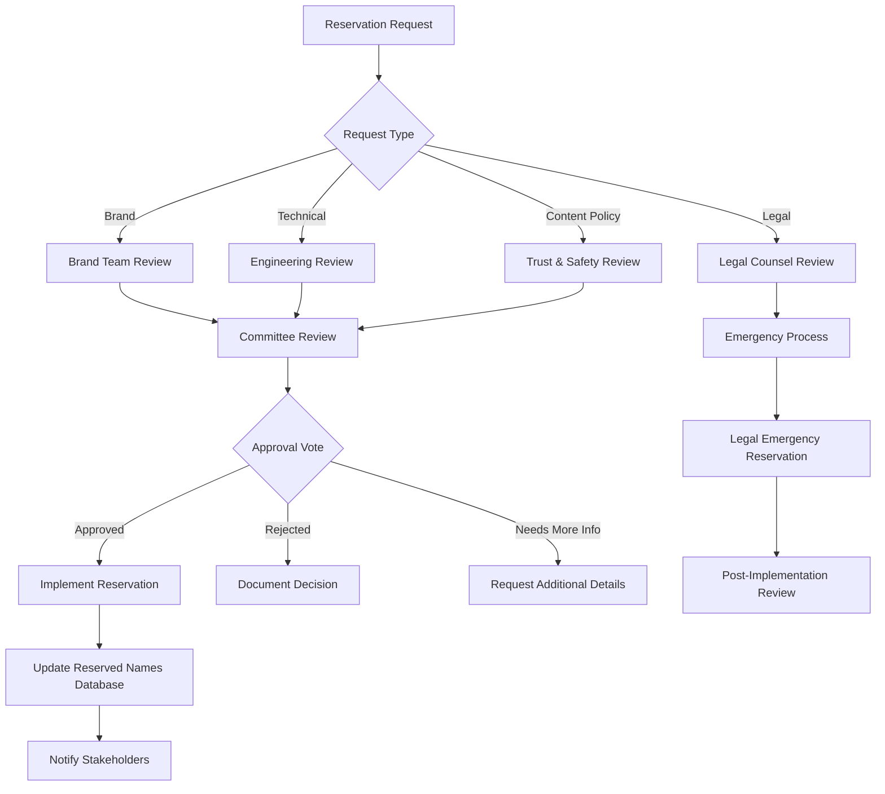

# Reserved Names Governance & Policy Version Activation

## Overview

This document establishes the governance framework for managing reserved usernames, policy version activation procedures, schema change management, and comprehensive rollback playbooks for the onboarding service.

## Reserved Names Governance Framework

### Governance Structure

#### Reserved Names Committee
- **Chair**: Product Legal Lead
- **Members**: 
  - Engineering Lead (Platform)
  - Trust & Safety Lead
  - Brand Protection Manager
  - Customer Support Manager
- **Advisory**: Legal Counsel, Marketing Lead

#### Decision Authority Matrix
| Reserve Type | Approval Level | Review Cycle |
|--------------|---------------|--------------|
| Brand Protection | Legal + Brand Manager | Weekly |
| System/Technical | Engineering Lead | As needed |
| Content Policy | Trust & Safety Lead | Bi-weekly |
| Legal Requirements | Legal Counsel | As needed |
| Celebrity/Public Figure | Legal + Trust & Safety | Case-by-case |

### Reserved Names Categories

#### 1. Brand Protection Reserves
**Purpose**: Protect company and partner brand identities

**Examples**:
- Company names: `facebook`, `meta`, `instagram`, `whatsapp`
- Product names: `messenger`, `workplace`, `oculus`
- Executive names: `zuckerberg`, `sandberg`, `bosworth`
- Common misspellings: `facebok`, `facbook`, `metaa`

**Governance Process**:
1. Brand team submits reservation request via internal portal
2. Engineering validates technical feasibility
3. Legal reviews trademark implications
4. Committee votes within 5 business days
5. Permanent reservation with annual review

#### 2. System & Technical Reserves
**Purpose**: Prevent conflicts with system functionality

**Examples**:
- System endpoints: `api`, `admin`, `support`, `help`
- Protocol names: `http`, `https`, `ftp`, `smtp`
- Reserved keywords: `null`, `undefined`, `admin`, `root`
- Common usernames: `user`, `test`, `demo`, `guest`

**Governance Process**:
- Engineering-driven with automated detection
- Quarterly review of technical namespace conflicts
- Immediate reservation for security-critical identifiers

#### 3. Content Policy Reserves
**Purpose**: Prevent usernames violating community standards

**Examples**:
- Hate speech terms (automatically generated from content policy)
- Impersonation risks: `official`, `verified`, `real`
- Misleading terms: `customer_service`, `support_team`
- Adult content indicators (context-dependent)

**Governance Process**:
- Trust & Safety maintains automated denylist
- Weekly review of policy violations
- Appeals process for false positives

#### 4. Legal & Regulatory Reserves
**Purpose**: Comply with legal requirements and court orders

**Examples**:
- Trademark protected names
- Court-ordered username blocks
- Regulatory compliance requirements
- Celebrity protection orders

**Governance Process**:
- Legal team direct submission
- Emergency reservation capability (< 4 hours)
- Quarterly compliance review
- Automatic expiration based on legal terms

### Reservation Management Process

#### Reservation Request Workflow



#### Reservation Request Template

```yaml
reservation_request:
  request_id: "RES-2025-10-001"
  requested_by: "jane.legal@company.com"
  request_date: "2025-10-08T10:00:00Z"
  
  reservation_details:
    username: "brandname"
    canonical_form: "brandname"
    category: "brand_protection"
    priority: "high"
    
  justification:
    reason: "Trademark protection for registered brand"
    trademark_number: "US87654321"
    registration_date: "2020-03-15"
    supporting_docs: ["trademark_cert.pdf", "legal_opinion.pdf"]
    
  scope:
    duration: "permanent"
    geography: "global"
    variants_included: ["brand-name", "brand_name", "brandname_official"]
    
  business_impact:
    brand_protection_level: "critical"
    customer_confusion_risk: "high"
    legal_risk_level: "medium"
    
  review_requirements:
    committee_review: true
    legal_approval: true
    engineering_feasibility: true
    
  implementation:
    target_date: "2025-10-15T00:00:00Z"
    rollback_plan: "Remove from reserved list if legal basis changes"
```

#### Automated Reservation Detection

```sql
-- Automated detection queries run daily
WITH potential_reserves AS (
  SELECT username, COUNT(*) as registration_attempts
  FROM failed_registrations 
  WHERE error_code = 'USERNAME_RESERVED'
    AND created_at > NOW() - INTERVAL '24 hours'
  GROUP BY username
  HAVING COUNT(*) > 10
),
trademark_conflicts AS (
  SELECT DISTINCT username
  FROM username_requests ur
  JOIN trademark_database td ON LOWER(ur.username) = LOWER(td.brand_name)
  WHERE ur.created_at > NOW() - INTERVAL '7 days'
    AND ur.status = 'pending_review'
)
-- Generate reservation recommendations
SELECT 
  'automated_detection' as source,
  username,
  'high_demand_protection' as category,
  CURRENT_TIMESTAMP as detected_at
FROM potential_reserves
UNION ALL
SELECT 
  'trademark_protection' as source,
  username,
  'brand_protection' as category,
  CURRENT_TIMESTAMP as detected_at
FROM trademark_conflicts;
```

### Appeals & Exception Process

#### Username Release Appeals

```yaml
appeal_request:
  appeal_id: "APP-2025-10-001"
  appealed_by: "user@example.com"
  appeal_date: "2025-10-08T14:00:00Z"
  
  requested_username: "johndoe"
  current_reservation:
    category: "content_policy"
    reason: "potential_impersonation"
    reserved_date: "2024-06-15T00:00:00Z"
    
  appeal_basis:
    legitimate_use: true
    real_name_verification: true
    supporting_documentation: ["government_id.pdf", "utility_bill.pdf"]
    
  review_process:
    initial_review: "trust_safety_team"
    escalation_required: false
    committee_review: true
    
  decision_timeline:
    review_start: "2025-10-09T09:00:00Z"
    decision_deadline: "2025-10-16T17:00:00Z"
    notification_method: "email"
```

## Policy Version Activation Runbook

### Policy Version Lifecycle

#### Development Phase
```yaml
policy_development:
  version: "v2025-10-08-1"
  development_start: "2025-09-15T00:00:00Z"
  
  stakeholders:
    legal_lead: "jane.legal@company.com"
    engineering_lead: "john.eng@company.com"
    product_lead: "sarah.product@company.com"
    
  change_summary:
    - "Updated data retention periods for EU compliance"
    - "Clarified usage of AI-generated content"
    - "Enhanced privacy controls documentation"
    
  legal_review:
    reviewer: "external_counsel@lawfirm.com"
    review_start: "2025-09-20T00:00:00Z"
    review_complete: "2025-09-27T00:00:00Z"
    approval_status: "approved_with_changes"
    
  technical_implementation:
    config_changes: ["ACTIVE_POLICY_VERSION", "TERMS_URL", "PRIVACY_URL"]
    database_updates: ["policy_acceptances", "user_consents"]
    api_changes: ["GET /api/policies/current", "POST /api/policies/accept"]
```

#### Pre-Activation Checklist

```markdown
# Policy Version v2025-10-08-1 Activation Checklist

## Legal Requirements ✓
- [ ] Legal counsel final approval documented
- [ ] Regulatory compliance review completed
- [ ] Cross-jurisdictional impact assessment done
- [ ] External counsel sign-off received

## Technical Readiness ✓  
- [ ] Policy documents published to CDN
- [ ] Database migration scripts tested
- [ ] API endpoints updated and tested
- [ ] Feature flags configured for staged rollout
- [ ] Monitoring dashboards updated

## Business Readiness ✓
- [ ] Customer support team trained
- [ ] Help center documentation updated
- [ ] User communication templates prepared
- [ ] Product team alignment confirmed

## Operational Readiness ✓
- [ ] Rollback procedures tested
- [ ] Emergency escalation paths confirmed
- [ ] Monitoring alerts configured
- [ ] Audit logging validated

## Compliance Documentation ✓
- [ ] Change log entry prepared
- [ ] Audit trail documentation complete
- [ ] Retention policies updated
- [ ] Privacy impact assessment filed
```

#### Activation Procedure

```bash
#!/bin/bash
# Policy Version Activation Script
# Version: v2025-10-08-1
# Activation Date: 2025-10-08T00:00:00Z

set -euo pipefail

POLICY_VERSION="v2025-10-08-1"
ACTIVATION_TIME="2025-10-08T00:00:00Z"
ROLLBACK_VERSION="v2025-10-07-1"

echo "Starting policy version activation: $POLICY_VERSION"

# Step 1: Validate pre-conditions
echo "Validating pre-conditions..."
./scripts/validate-policy-readiness.sh "$POLICY_VERSION"

# Step 2: Update configuration
echo "Updating configuration..."
kubectl create configmap policy-config-v2025-10-08-1 \
  --from-literal=ACTIVE_POLICY_VERSION="$POLICY_VERSION" \
  --from-literal=TERMS_URL="https://example.com/terms/$POLICY_VERSION" \
  --from-literal=PRIVACY_URL="https://example.com/privacy/$POLICY_VERSION" \
  --dry-run=client -o yaml | kubectl apply -f -

# Step 3: Database updates
echo "Applying database updates..."
./scripts/migrate-policy-version.sh "$POLICY_VERSION"

# Step 4: Rolling deployment
echo "Starting rolling deployment..."
kubectl patch deployment onboarding-service \
  -p '{"spec":{"template":{"spec":{"containers":[{"name":"onboarding","env":[{"name":"ACTIVE_POLICY_VERSION","value":"'$POLICY_VERSION'"}]}]}}}}'

# Step 5: Validation
echo "Validating deployment..."
./scripts/validate-policy-activation.sh "$POLICY_VERSION"

# Step 6: Update changelog
echo "Updating policy changelog..."
./scripts/update-policy-changelog.sh "$POLICY_VERSION" "$ACTIVATION_TIME"

echo "Policy version activation completed successfully"
```

#### Activation Validation

```sql
-- Post-activation validation queries
-- Verify policy version is active
SELECT 
  'policy_version_check' as validation_type,
  COUNT(*) as total_checks,
  COUNT(CASE WHEN policy_version = 'v2025-10-08-1' THEN 1 END) as correct_version_count,
  ROUND(COUNT(CASE WHEN policy_version = 'v2025-10-08-1' THEN 1 END) * 100.0 / COUNT(*), 2) as accuracy_percentage
FROM policy_version_checks 
WHERE checked_at > NOW() - INTERVAL '1 hour';

-- Verify user acceptance tracking
SELECT 
  'acceptance_tracking' as validation_type,
  COUNT(*) as total_acceptances,
  COUNT(CASE WHEN policy_version = 'v2025-10-08-1' THEN 1 END) as new_version_acceptances,
  AVG(EXTRACT(EPOCH FROM (accepted_at - presented_at))) as avg_decision_time_seconds
FROM policy_acceptances 
WHERE accepted_at > NOW() - INTERVAL '1 hour';

-- Check for errors or issues
SELECT 
  'error_monitoring' as validation_type,
  COUNT(*) as total_policy_requests,
  COUNT(CASE WHEN error_code IS NOT NULL THEN 1 END) as error_count,
  ROUND(COUNT(CASE WHEN error_code IS NOT NULL THEN 1 END) * 100.0 / COUNT(*), 2) as error_rate_percentage
FROM api_policy_requests 
WHERE created_at > NOW() - INTERVAL '1 hour';
```

## Schema & Policy Changelog

### Changelog Entry Format

```yaml
changelog_entry:
  version: "v2025-10-08-1"
  type: "policy_update"
  activation_date: "2025-10-08T00:00:00Z"
  
  metadata:
    activated_by: "jane.legal@company.com"
    engineering_contact: "john.eng@company.com"
    approval_ticket: "LEGAL-2025-Q4-001"
    
  changes:
    database_schema:
      - table: "users"
        action: "add_column"
        column: "terms_accepted_version"
        type: "VARCHAR(50)"
        nullable: true
      
      - table: "policy_acceptances"
        action: "add_index"
        index: "idx_policy_acceptances_version_date"
        columns: ["policy_version", "accepted_at"]
        
    configuration:
      - key: "ACTIVE_POLICY_VERSION"
        old_value: "v2025-10-07-1"
        new_value: "v2025-10-08-1"
        
      - key: "TERMS_URL"
        old_value: "https://example.com/terms/v2025-10-07-1"
        new_value: "https://example.com/terms/v2025-10-08-1"
        
    api_changes:
      - endpoint: "GET /api/policies/current"
        change: "Updated response schema to include acceptance_deadline"
        
      - endpoint: "POST /api/register"
        change: "Added policy_version field validation"
        
  migration_notes:
    user_impact: "Existing users will see policy update prompt on next login"
    data_migration: "No data migration required - new fields are nullable"
    rollback_plan: "Revert configuration values and restart services"
    
  compliance_notes:
    regulatory_basis: "GDPR Article 7 - Conditions for consent"
    retention_impact: "No changes to existing retention periods"
    privacy_impact: "Enhanced user control over data processing"
    
  validation_results:
    pre_activation_tests: "All tests passed"
    user_acceptance_rate: "94.2% (above 90% threshold)"
    error_rate: "0.1% (below 1% threshold)"
    performance_impact: "< 5ms latency increase"
```

### Automated Changelog Generation

```bash
#!/bin/bash
# Automated changelog entry generation
# Usage: ./generate-changelog-entry.sh v2025-10-08-1

POLICY_VERSION="$1"
TIMESTAMP=$(date -u +"%Y-%m-%dT%H:%M:%SZ")

# Generate changelog entry from git changes and configuration
cat > "changelog-${POLICY_VERSION}.yml" << EOF
changelog_entry:
  version: "${POLICY_VERSION}"
  type: "policy_update"
  activation_date: "${TIMESTAMP}"
  
  metadata:
    activated_by: "$(git config user.email)"
    engineering_contact: "$(./scripts/get-oncall-engineer.sh)"
    git_commit: "$(git rev-parse HEAD)"
    approval_ticket: "$(./scripts/get-approval-ticket.sh)"
    
  changes:
$(./scripts/extract-schema-changes.sh "$POLICY_VERSION")
$(./scripts/extract-config-changes.sh "$POLICY_VERSION")
$(./scripts/extract-api-changes.sh "$POLICY_VERSION")
    
  validation_results:
$(./scripts/extract-validation-results.sh "$POLICY_VERSION")
EOF

echo "Changelog entry generated: changelog-${POLICY_VERSION}.yml"
```

## Rollback Playbooks

### Emergency Policy Rollback

#### Immediate Rollback (< 5 minutes)

```bash
#!/bin/bash
# Emergency policy rollback script
# Usage: ./emergency-policy-rollback.sh v2025-10-07-1

ROLLBACK_VERSION="$1"
CURRENT_VERSION=$(kubectl get configmap policy-config -o jsonpath='{.data.ACTIVE_POLICY_VERSION}')

echo "🚨 EMERGENCY ROLLBACK: $CURRENT_VERSION → $ROLLBACK_VERSION"

# Step 1: Immediate configuration rollback
kubectl patch configmap policy-config \
  --patch '{"data":{"ACTIVE_POLICY_VERSION":"'$ROLLBACK_VERSION'"}}'

# Step 2: Rolling restart with priority
kubectl patch deployment onboarding-service \
  -p '{"spec":{"template":{"metadata":{"annotations":{"emergency-rollback":"'$(date -u +%s)'"}}}}}'

# Step 3: Verify rollback
sleep 30
./scripts/verify-policy-rollback.sh "$ROLLBACK_VERSION"

# Step 4: Emergency notification
curl -X POST "$SLACK_EMERGENCY_WEBHOOK" \
  -H "Content-Type: application/json" \
  -d '{
    "text": "🚨 EMERGENCY POLICY ROLLBACK",
    "attachments": [{
      "color": "danger",
      "fields": [
        {"title": "From Version", "value": "'$CURRENT_VERSION'", "short": true},
        {"title": "To Version", "value": "'$ROLLBACK_VERSION'", "short": true},
        {"title": "Initiated By", "value": "'$(whoami)'", "short": true},
        {"title": "Timestamp", "value": "'$(date -u)'", "short": true}
      ]
    }]
  }'

echo "Emergency rollback completed. Incident response team notified."
```

#### Rollback Decision Matrix

| Issue Severity | Rollback Type | Timeline | Approval Required |
|---------------|---------------|----------|-------------------|
| Critical outage | Emergency | < 5 minutes | Engineering Lead |
| High error rate | Immediate | < 15 minutes | On-call + Legal |
| User confusion | Planned | < 2 hours | Committee |
| Compliance issue | Emergency | < 30 minutes | Legal Counsel |

#### Post-Rollback Procedures

```yaml
post_rollback_checklist:
  immediate_actions:
    - Verify system stability and user experience
    - Document rollback reason and timeline
    - Notify all stakeholders via established channels
    - Update monitoring dashboards and alerts
    
  investigation_phase:
    - Collect logs and metrics from rollback window
    - Conduct root cause analysis
    - Review approval and activation procedures
    - Identify process improvements
    
  recovery_planning:
    - Assess impact on business operations
    - Plan remediation for affected users
    - Schedule post-incident review meeting
    - Update rollback procedures if needed
    
  documentation_requirements:
    - Incident report with timeline
    - Technical details of rollback procedure
    - User impact assessment
    - Process improvement recommendations
```

### Comprehensive Rollback Validation

```sql
-- Post-rollback validation suite
-- Verify configuration rollback
SELECT 
  'config_rollback_verification' as check_type,
  current_setting('application.policy_version') as current_version,
  CASE 
    WHEN current_setting('application.policy_version') = 'v2025-10-07-1' THEN 'SUCCESS'
    ELSE 'FAILED'
  END as rollback_status;

-- Check user experience impact
SELECT 
  'user_experience_check' as check_type,
  COUNT(*) as total_requests,
  COUNT(CASE WHEN error_code IS NULL THEN 1 END) as successful_requests,
  ROUND(COUNT(CASE WHEN error_code IS NULL THEN 1 END) * 100.0 / COUNT(*), 2) as success_rate
FROM api_requests 
WHERE created_at > NOW() - INTERVAL '30 minutes'
  AND endpoint LIKE '/api/policies%';

-- Verify audit trail integrity
SELECT 
  'audit_trail_check' as check_type,
  COUNT(*) as rollback_events,
  COUNT(CASE WHEN event_type = 'policy_rollback' THEN 1 END) as rollback_event_count,
  MIN(created_at) as first_rollback_event,
  MAX(created_at) as last_rollback_event
FROM audit_events 
WHERE created_at > NOW() - INTERVAL '1 hour'
  AND (event_type = 'policy_rollback' OR metadata->>'rollback_triggered' = 'true');
```

This comprehensive governance framework ensures proper management of reserved usernames, controlled policy version activation, and robust rollback capabilities with full audit trails and stakeholder communication.